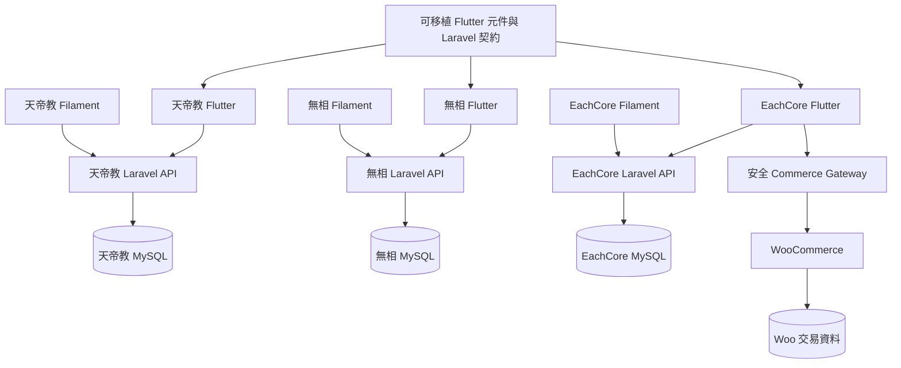
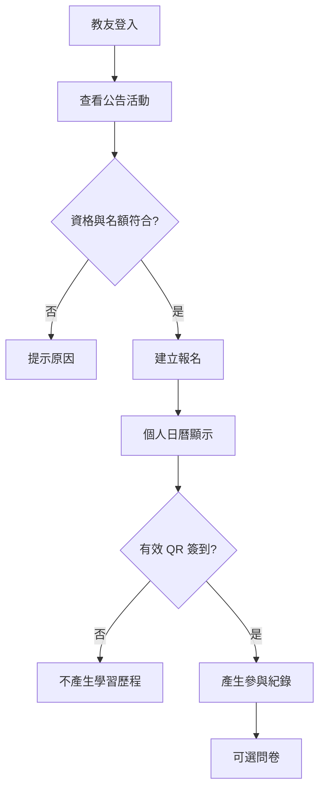
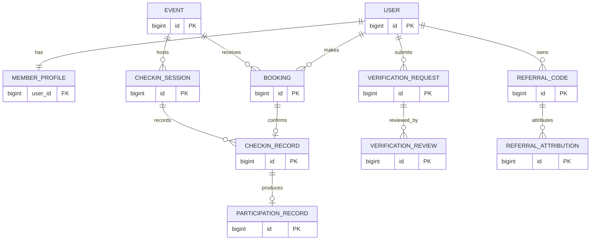
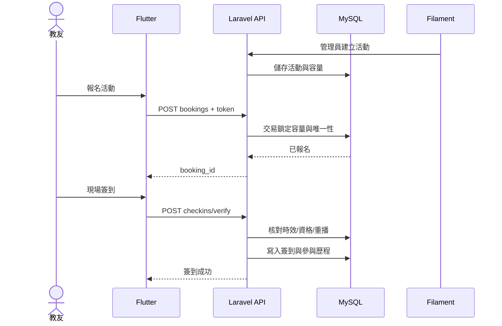
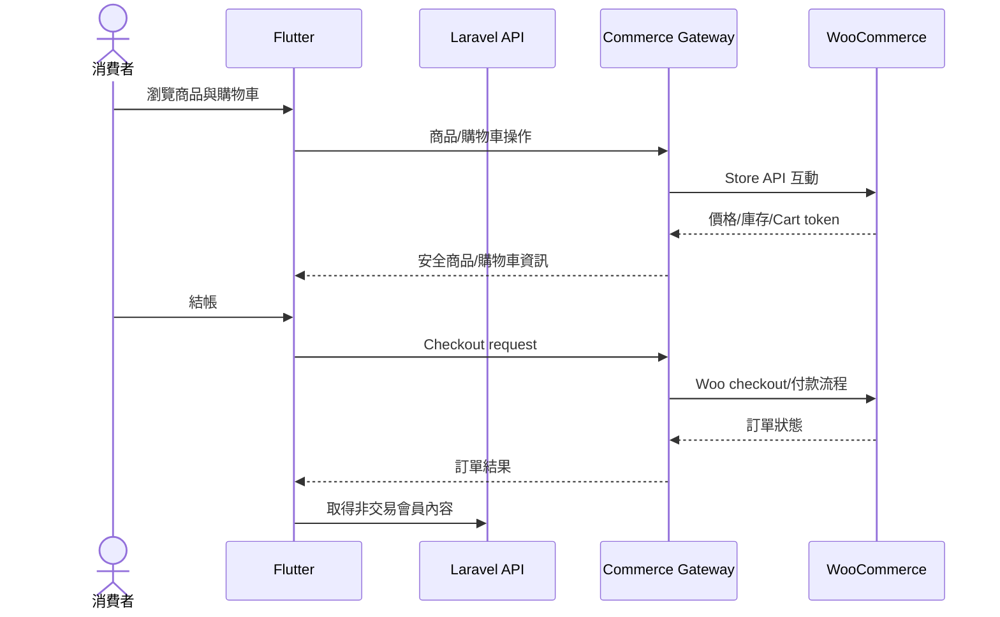
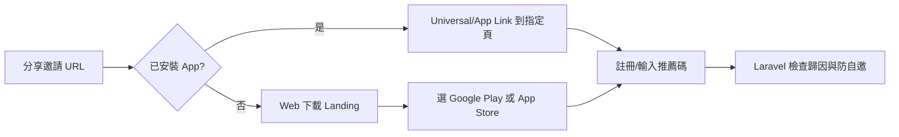

# 三大 App｜共用基礎 PoC v1.0 技術規格與完整驗收計畫
**版本**：v1.0　**日期**：2026-10-22　**文件狀態**：待執行／待驗收　**主要依據**：《三大 App 共用模組功能需求規格書 v1.0》與《三大 App 完整計畫 v8.0》
> 本文件是「執行與驗收計畫」，不是測試結果。所有項目初始狀態為 **NOT TESTED**；除非取得實際測試證據，絕不標記 PASS。所列 API、Schema 與套件版本為擬議基線，實作時需經鎖版、Migration 與 OpenAPI 校驗。
## 0｜不可違反的架構決策與成功定義
1. **先共用基礎 PoC，再開發天帝教親和網正式 MVP**；無相氣學、EachCore 分別有獨立的驗收計畫，並不宣稱同時上線。
2. 三個 App 都採 Flutter Android/iOS + Laravel REST API + Filament Web Admin + MySQL；三個 App 可重用程式與契約，**預設各自資料庫、會員與部署環境獨立**，不預建中央 SSO 或多租戶服務。
3. **EachCore 雙後端**：Laravel/Filament 負責非交易業務，WooCommerce 暫時負責商品、庫存、購物車、結帳、訂單、退款與交易狀態。Flutter 不得內含 WooCommerce 管理金鑰。
4. **兩個團體 App 不開發 App 內私募贊助、捐款付款、贊助訂單、捐款收據或金流 API**；若有中性支持資訊頁，僅一般 CMS 文字，文案上線前須審查，不設付款導流。宗教「認捐」業務若未釐清法律與操作定義，列為 BLOCKED 且不納入 MVP。
5. **EachCore 現階段不做 IoT 裝置連線、BLE/Wi-Fi 配對、OTA、裝置 API**；IoT 語音助理保留為未來主力硬體商品。
6. **Membership Level（VIP）、Role/Permission（操作權限）、Identity Verification（身分核實）互相獨立**；不可用 VIP 自動授予管理權，亦不可把專業認證徽章等同會員付費。
7. **Booking → Calendar → Check-in → Learning/Participation History → optional Survey** 是相互關聯的流程；預約不等於實際出席，未簽到不可自動算學習時數。
8. Sanctum 使用 Laravel 標準 personal access token（opaque bearer token）；不以 JWT 作為預設；REST 優先，不強制 GraphQL、Redis、WebSocket、Kubernetes、微服務或先建大型共用平台。
9. 不在文件中預先宣稱已通過 Android/iOS、資安、法規、付款或硬體測試。實際驗收以證據與版本指紋為準。

## 1｜範圍、交付物、階段與責任
| 階段 | 交付成果 | 入口條件 | 出口 Gate | 優先級 |
|---|---|---|---|---|
| P0 共用 PoC | Laravel/Filament/MySQL/Sanctum、Flutter 登入公告、CI、測試部署 | GitHub、開發環境可用 | G0–G4 | 立即 |
| P1 天帝教 MVP | 教友資料、公告、活動報名、QR 簽到、歷程、推薦分享 | PoC 全部 P0 通過 | G5–G7 | 第一個正式 App |
| P2 無相氣學 MVP | 學員、課程、推拿/活動預約、日曆、簽到、歷程 | 共用模組版本已標記 | G8 | 後續 |
| P3 EachCore MVP | Laravel 會員/內容＋WooCommerce 實體商品交易 | Woo sandbox 與安全 gateway 可用 | G9 | 後續 |
| P4 雙平台上架 | 簽章、商店隱私資訊、帳號刪除、商店審查 | 該 App 所有 P0 測試通過 | G10 | 逐 App |

### 1.1 驗收產物清單（每個 App 分別保存）
- `README.md`：安裝、啟動、環境變數範例、常見錯誤、復原方式；`architecture.md`：邊界與資料流。
- `openapi.yaml`：API 規格；`schema/`：Migration 與 ER；`tests/`：自動化測試；`docs/acceptance/`：逐項證據。
- Flutter Android Debug APK、Release AAB；iOS 在具合法 macOS/Xcode 建置條件時產生 IPA／TestFlight 版本。Ubuntu 不能直接完成正式 iOS 簽章編譯。
- Filament 後台測試網址、測試角色、最小權限證明；MySQL 備份檔與還原紀錄。
- 每次驗收保存 Git commit SHA、套件 lockfile hash、Migration batch、API 版本、App build number、測試裝置/OS、測試時間。
### 1.2 分工與環境
| 角色/工具 | 工作 | 不可代替的人工確認 |
|---|---|---|
| 使用者（產品負責人） | 決定需求、核准資料欄位與權限、排優先級、審 PR/發布 | 宗教/學員實際制度、文案、帳務與個資蒐集目的 |
| ChatGPT | 規格、架構審查、風險與驗收測例 | 不宣稱未跑過的測試 PASS |
| Claude Code | 修改程式、產生 Migration/測試、修復 CI | 重大 schema/權限/金流變更需 PR 審核 |
| Ubuntu 開發機 | PHP/Composer、Flutter Android、MySQL、測試、Git、靜態分析 | 不當作正式 iOS build host；正式後端不依賴本機常駐 |
| macOS + Xcode／合法雲端 macOS CI | iOS 簽章、IPA/TestFlight、真機測試 | Apple 開發者帳號及憑證由負責人管理 |
| GitHub | Issue/PR、分支、Actions、Release | 不將金鑰或真實會員資料推入 Repo |

## 2｜技術版本基線、相容性與鎖版
**版本策略**：本文件不假定某個最新主版已與所有套件相容；開發啟動時以官方相容矩陣與最小實機 PoC 確認。以下是建議的版本政策，而非已驗證的固定版本。
| 元件 | 建議選型／版本規則 | 驗證命令／證據 | Gate |
|---|---|---|---|
| Flutter/Dart | 同一 stable channel、Flutter SDK 固定精確版本；Dart 隨 SDK | `flutter --version`; `flutter doctor -v`; `pubspec.lock` | P0 |
| Android | Android SDK/Gradle/Kotlin/AGP 依 Flutter 官方相容矩陣；固定 compile/target SDK | `flutter build appbundle`; 實機測試 | P0 |
| iOS | 符合當期 App Store 的 Xcode/iOS SDK，實際用 macOS CI 鎖定 | `xcodebuild -version`; TestFlight | 上架前 |
| PHP | Laravel 當期支援的 PHP 版本；先驗 PHP 8.3/8.4 與擴充 | `php -v`; `php -m` | P0 |
| Laravel | 以官方當期穩定且受支援版本為準；記錄 exact `laravel/framework` | `composer show laravel/framework`; `composer.lock` | P0 |
| Filament | 選與 Laravel/PHP 相容的受維護正式主版，避免不相容套件 | `composer show filament/filament`; 後台 CRUD | P0 |
| Sanctum | 選與 Laravel 主版相容版本；personal access token | `composer show laravel/sanctum`; 401/403 測試 | P0 |
| MySQL | MySQL 8.0+ 相容版本；正式以服務供應商支援為準 | `SELECT VERSION()`；Migration rollback | P0 |
| Flutter state | Riverpod（優先）或 Bloc 二擇一；不可同時作為主狀態層 | Widget test、登入狀態測試 | P0 |
| HTTP/Router | Dio + go_router（版本由 pubspec.lock 固定） | 錯誤攔截、deep link 實測 | P0 |
| API schema | OpenAPI 3.1 或工具相容 3.0，統一 `/api/v1` | lint、contract test | P0 |
| WooCommerce | 現行受維護 WooCommerce/WordPress 版本；沙盒驗證 Store/REST API | 官方版本畫面、測試單 | EachCore |
**版本凍結程序**：先建測試分支 → 在乾淨環境安裝 → 執行 smoke tests → 記錄 lockfiles → 產生版本清單 → PR 核准 → 打 tag。任何 major upgrade 必須重新執行 API、權限、資料庫及 Flutter 回歸測試。

## 3｜專案目錄與程式共用方式
**建議**：第一個 Repo 以天帝教親和網 PoC 為主，最初只保留最小 `shared` 原始碼目錄；確定第二個 App 真正需要時，才抽出 versioned packages。不要一開始就建立一套需要維護的共用伺服器。
```text
three-apps-workspace/                  # 開發工作區（不代表正式共用部署）
  docs/
    architecture.md
    openapi/contract.yaml
    acceptance/
  shared/
    flutter_packages/
      app_core/                         # API error/auth/router 等經驗證才抽取
      ui_kit/                           # 共用 UI 元件
    laravel_packages/                   # 後續必要時才抽出
  tiandi/
    mobile/                             # Flutter 專案
      lib/app/
      lib/core/{api,auth,router,storage}/
      lib/features/{profile,notices,events,booking,calendar,checkin,referral}/
      test/
      integration_test/
    backend/                            # Laravel 專案
      app/{Http/Controllers/Api,Models,Policies,Services,Filament}/
      database/{migrations,factories,seeders}/
      routes/{api,web}.php
      tests/{Feature,Unit}/
      storage/                           # 不提交正式上傳內容
  wuxiang/
    mobile/
    backend/
  eachcore/
    mobile/
    backend/                             # Laravel 非交易
    commerce-adapter/                    # Laravel 內部介面，非第二套金流
  .github/workflows/
```
**目錄驗收**：每個 App 可獨立執行安裝與測試；`shared` 沒有任何跨 App 會員 ID、正式 DB 密碼、品牌字串硬編碼；每個 App 有自己的 `.env.example`，但 `.env` 與密鑰不進 Git。

## 4｜資料模型、Migration 與資料權責
### 4.1 共用基礎 PoC 最小 Schema
| 表 | 主要欄位（示意） | 索引／限制 | 建立階段 |
|---|---|---|---|
| users | id,email,password_hash,status,email_verified_at | UNIQUE(email)；狀態 enum/constraint | P0 |
| personal_access_tokens | Sanctum 標準欄位 | 依 Sanctum 官方 migration | P0 |
| member_profiles | user_id,display_name,locale,timezone,avatar_path | UNIQUE(user_id)；FK users | P0 |
| roles/permissions/model_has_roles | Spatie Permission 官方 schema 或 Policies-only 二選一 | 角色不得與 VIP 混淆 | P0 |
| notices | id,title,body,status,published_at,created_by | status,published_at 索引 | P0 |
| audit_events | actor_id,action,entity_type,entity_id,created_at,meta_safe | 索引 actor/time；不得記錄 token/敏感原文 | P0 |
| member_levels | id,code,rank,active | UNIQUE(code) | P1（如 MVP 真有等級規則） |
| user_level_assignments | user_id,level_id,start_at,end_at | 同時有效的衝突規則 | P1 |
| verification_requests | user_id,type,status,submitted_at | 依 App 分別擴充審核條件 | P1 |
| verification_reviews | request_id,reviewer_id,decision,reason | 防重複審核與自己審自己 | 後期多審核 |
| events | id,type,title,start_at,end_at,capacity,status | start/end/status 索引 | P1 |
| bookings | id,user_id,bookable_type,bookable_id,status,created_at | 同活動重複報名唯一規則 | P1 |
| checkin_sessions | id,event_id,start_at,end_at,secret_ref | 不得存可重用明文簽到密鑰 | P1 |
| checkin_records | id,booking_id,session_id,checked_in_at,verified_by | UNIQUE(booking_id,session_id) | P1 |
| participation_records | id,user_id,event_id,checkin_id,minutes | UNIQUE(checkin_id)；不能靠報名產生 | P1 |
| notification_preferences | user_id,category,channel,enabled | UNIQUE(user_id,category,channel) | P1 |
| referral_codes | id,user_id,code,active | UNIQUE(code) | P1 |
| referral_attributions | inviter_id,invitee_id,code_id,attributed_at | UNIQUE(invitee_id,program_id) 視政策 | P1 |
| calendar_views | 不建實體表，依 booking/event 查詢組合 | 避免雙寫資料 | P1 |
### 4.2 三個 App 的資料權責與禁止跨用
| 資料類型 | 天帝教親和網 | 無相氣學 | EachCore |
|---|---|---|---|
| 會員/角色 | 獨立 MySQL | 獨立 MySQL | Laravel 自有會員與 Woo customer mapping |
| 教友/學員認證 | 教友資格、分院 | 學員、講師/助教 | 初期帳號核實；專業徽章後期 |
| 課程/活動/預約 | Laravel | Laravel | Laravel 活動；預購/搶購與 Woo 訂單分開 |
| 實際簽到/歷程 | Laravel | Laravel | 後期 UI 才啟用 |
| 商品/價格/庫存/購物車/訂單 | 不適用 | 不適用 | WooCommerce 為唯一權威 |
| 非交易內容/通知/標籤 | Laravel | Laravel | Laravel |
| 贊助收款/捐款收據 | 禁止建模 | 禁止建模 | 不適用 |
| IoT 連線/裝置 API | 不適用 | 不適用 | 本階段禁止 |
### 4.3 Migration 與資料安全驗收規則
- 每個 Migration 可在乾淨 DB 上重播；資料表有 FK/UNIQUE/必要索引；`migrate:fresh --seed` **只能在專用測試 DB** 使用。
- 生產資料庫不使用 destructive reset；正式 Migration 先備份、dry-run、review；回滾需測試並注意資料不可逆。
- 所有測試資料皆為合成資料，不上傳真實宗教身分、學員個資、身心狀態、付款資料。
- `calendar` 採 API 投影，不能把每次預約再同步複製到第二張日曆主表；取消預約須立即反映。

## 5｜REST API 契約與錯誤規範
**統一格式**：成功 `{data,meta}`；錯誤 `{error:{code,message,fields?,request_id}}`；API `Content-Type: application/json`；時間 ISO-8601 帶時區，DB UTC；分頁 cursor 或 page 由單一規範固定；429 含 Retry-After。
| Method | Path | 身分 | 功能 | 主要驗收 |
|---|---|---|---|---|
| POST | /api/v1/auth/login | 訪客 | 帳密登入 | 正確 200 token；錯誤 401/422；限流 |
| POST | /api/v1/auth/logout | 會員 | 撤銷目前 token | 舊 token 再請求 401 |
| GET | /api/v1/me | 會員 | 自身摘要 | 不能取其他 user ID |
| GET | /api/v1/me/profile | 會員 | 詳細個資 | 只回傳本人有權讀取欄位 |
| PATCH | /api/v1/me/profile | 會員 | 更新本人資料 | 驗證/欄位白名單/審計 |
| GET | /api/v1/notices | 公開/會員 | 公告列表 | 只列已發布及可見範圍 |
| GET | /api/v1/notices/{id} | 公開/會員 | 公告詳情 | 未發布不可外洩 |
| GET | /api/v1/events | 會員 | 活動列表 | 時區/名額/狀態 |
| POST | /api/v1/events/{id}/bookings | 會員 | 活動報名 | 冪等、防超賣、避免重複 |
| DELETE | /api/v1/bookings/{id} | 本人/管理者 | 取消報名 | 依取消政策更新 |
| GET | /api/v1/me/calendar | 會員 | 個人日曆 | 只含有效預約/事件 |
| POST | /api/v1/checkins/verify | 有權工作人員/會員依模式 | 簽到驗證 | 限時、一次性、防重播 |
| GET | /api/v1/me/history | 會員 | 參與/學習歷程 | 只含已核實完成 |
| GET | /api/v1/notifications/preferences | 會員 | 通知偏好 | 分類及通道 |
| PUT | /api/v1/notifications/preferences | 會員 | 更新偏好 | 禁止覆蓋必要安全通知 |
| GET | /api/v1/referrals/me | 會員 | 推薦碼與成效 | 不得揭露他人敏感資料 |
| GET | /api/v1/links/{slug} | 訪客 | 公開分享解析 | 未知/失效安全降級 |
| POST | /api/v1/referrals/attribute | 註冊流程 | 推薦歸因 | 防自邀/防重複 |
| GET | /api/v1/products | EachCore 公開 | 商品目錄投影 | 資料來自 Woo，不雙寫價格 |
| POST | /api/v1/commerce/checkout-session | EachCore 會員/訪客依策略 | 結帳交接 | 憑證只留後端；價格以 Woo 為準 |
| GET | /api/v1/commerce/orders/{id} | EachCore 會員 | 訂單狀態 | 僅本人訂單、來源 Woo |
**API 契約審查**：`/api/v1` 必須由 Laravel `routes/api.php` 提供；Filament 只操作管理頁與同一服務層，不直接對 Flutter 暴露 Filament 內部 endpoint。OpenAPI 每次改動要有 backward-compatibility 檢查。

## 6｜Flutter 畫面與 Filament 管理驗收對照
| 模組 | Flutter 畫面 | Filament Resource/Action | 測試觀察 |
|---|---|---|---|
| 登入/註冊 | 登入、註冊、登出、失敗重試 | Users/角色（不可看密碼） | 401/403/Token revoke |
| Member Profile | 個人首頁、聯絡、隱私、詳細欄位 | Profiles、欄位可見性 | 本人/他人欄位隔離 |
| Membership Level | 等級標籤、可用權益 | Levels、Assignments、Roles | VIP 不提升操作權 |
| Identity Verification | 申請、進度、補件（後期） | Requests、Review Queue | 未核准無徽章 |
| Notice & News | 公告列表、詳情、搜尋 | Notices CRUD、排程/置頂 | 未發布不顯示 |
| Featured Articles | 文章、按讚名單、留言 | Articles、Comments 審核 | 公開與隱私界線 |
| Booking | 活動/課程/服務、預約/取消 | Events、Bookings、容量管理 | 超額與重複防護 |
| Calendar | 月/週/列表、預約詳情 | 活動日程與例外 | 取消立即更新 |
| Check-in | 個人 QR 或簽到畫面、紀錄 | Sessions、掃碼/手動簽到 | 防重播、授權 |
| Survey | 可選回饋、送出狀態 | Forms、Results | 匿名性/單次提交 |
| Notification | 通知中心、類別偏好 | Templates、Send Log、Categories | 退訂尊重 |
| Marketing-Referral | Refer a Friend、分享頁 | Programs、Codes、Attributions | 邀請歸因 |
| Deep Link | 連結開啟/未安裝下載頁 | Links、Landing 文案 | iOS/Android 網域驗證 |
| Marketing | 活動 Banner/推廣頁 | Campaigns、Publish | 停用後不曝光 |
| Log Management | 無一般用戶日誌 UI | Audit Logs/安全告警 | 敏感資訊遮罩 |
| EachCore Commerce | 商品、購物車、結帳、訂單 | Laravel 只管理非交易；Woo 管交易 | 訂單一致性 |
**Flutter 通用畫面狀態**：loading、empty、offline、timeout、validation error、401 expired、403 forbidden、429 throttled、success、duplicate submit；對所有寫入操作防連點。**Filament** 每個 List/View/Create/Edit/Delete/Export/批次操作皆有 Policy 驗證，UI 隱藏不等於授權。

## 7｜GitHub／Claude Code／ChatGPT 工作流程與 CI
1. Issue：需求 ID（例如 `TD-BOOK-003`）、使用者故事、風險、API/Schema 變更、驗收案例與完成定義。
2. Branch：`feat/TD-BOOK-003`、`fix/...`；不得直接推送受保護 main。
3. Claude Code 依 Issue 實作；提交 Migration、Policy、Feature Test、Flutter Widget/Integration Test 與 OpenAPI 更新。
4. PR 模板要求：變更摘要、資料表/權限/個資/金流影響、測試輸出、回滾方案、畫面截圖或錄影、未完成風險。
5. GitHub Actions：Composer install → PHP syntax/Pint → PHPStan/Larastan（導入時）→ PHPUnit/Pest → Flutter analyze/test → OpenAPI lint → secret scan → dependency audit；Android build 於 release gate。
6. Code Review：至少產品負責人確認 P0 需求、授權及資料權責；涉及權限/資料庫/付款不得僅憑 AI 文字說明 Merge。
7. 合併後在乾淨測試環境跑 Migration、seed、端到端 smoke、備份還原；記錄 release tag，最後才部署。
8. 每次 Release 更新 CHANGELOG、API 契約、Migration 列表、已知問題與下一版風險。
**最低 CI 驗收**：PR 沒有測試結果不能合併；敏感資訊掃描出現真密鑰立刻 FAIL 並撤銷密鑰；migration 破壞相容性且無計畫立即 BLOCKED。

## 8｜逐項驗收制度：PASS／FAIL／BLOCKED／NOT TESTED
**狀態定義**：PASS = 有可重現證據且符合預期；FAIL = 已執行但不符合；BLOCKED = 受未解決前置條件阻擋；NOT TESTED = 尚未執行。所有測試預設 NOT TESTED。
**每筆測試紀錄模板**：`Test ID | Build/Commit | Tester | Device/OS | Env | Preconditions | Steps | Expected | Actual | Evidence | Status | Issue | Retest date`。
**證據命名**：`docs/acceptance/<app>/<test_id>/<timestamp>_{screenshot|log|video|api}.ext`；證據遮蔽姓名、電話、Token、付款資訊；不可用合成截圖冒充實測。
**放行規則**：每個 Gate 的 P0 案例全部 PASS，且沒有未解決 P0/P1 安全缺陷；P1 允許延後需明確批准並記錄。BLOCKED 不等於 PASS；不因預計功能後期開發而把 MVP 必做項標 PASS。

## 9｜共用基礎 PoC 驗收案例（P0）
### G0｜開發環境與版本鎖定
| ID | 優先 | 前置條件／操作步驟 | 預期結果（PASS 判準） | 狀態 | 證據 |
|---|---|---|---|---|---|
| `CORE-ENV-001` | P0 | 乾淨 Ubuntu 安裝 PHP/Composer/MySQL；執行版本命令 | 官方相容矩陣符合；鎖版檔提交 | NOT TESTED | 待附 |
| `CORE-ENV-002` | P0 | Flutter doctor、Android SDK、實機連線 | Flutter analyze 與 Debug APK 可執行 | NOT TESTED | 待附 |
| `CORE-ENV-003` | P0 | clone repo；複製 .env.example；依 README 安裝 | 新環境 1 次按文件成功啟動 | NOT TESTED | 待附 |
| `CORE-ENV-004` | P0 | 掃描 git history、env、log | 無真實金鑰/會員資料入版控 | NOT TESTED | 待附 |
| `CORE-ENV-005` | P1 | 檢查 iOS build host/帳號/憑證計畫 | 確認可用 macOS CI，未具備則標上架 BLOCKED | NOT TESTED | 待附 |

### G1｜Laravel、Filament、MySQL
| ID | 優先 | 前置條件／操作步驟 | 預期結果（PASS 判準） | 狀態 | 證據 |
|---|---|---|---|---|---|
| `CORE-DB-001` | P0 | 空 DB 執行 migrate/seed | 所有表與 FK 建立成功 | NOT TESTED | 待附 |
| `CORE-DB-002` | P0 | 執行測試 DB migration rollback/re-run | 可重建且無 schema 漂移 | NOT TESTED | 待附 |
| `CORE-DB-003` | P0 | 管理員登入 Filament 新增草稿公告 | 儲存成功，操作日誌存在 | NOT TESTED | 待附 |
| `CORE-DB-004` | P0 | 未授權會員直訪 Filament/管理 API | 403 或重新導向；不得洩漏資料 | NOT TESTED | 待附 |
| `CORE-DB-005` | P0 | 建立 DB 備份、刪除測試 DB、還原 | 還原後公告/會員測試資料一致 | NOT TESTED | 待附 |
| `CORE-DB-006` | P1 | 時區轉換 UTC↔Asia/Taipei | API 與 UI 時間一致，無跨日偏移 | NOT TESTED | 待附 |

### G2｜Sanctum、Flutter Auth、API
| ID | 優先 | 前置條件／操作步驟 | 預期結果（PASS 判準） | 狀態 | 證據 |
|---|---|---|---|---|---|
| `CORE-AUTH-001` | P0 | 正確測試帳密登入 | 取得 token，Flutter me/profile 成功 | NOT TESTED | 待附 |
| `CORE-AUTH-002` | P0 | 錯誤密碼、空值、惡意輸入 | 401/422；無 token；限流 | NOT TESTED | 待附 |
| `CORE-AUTH-003` | P0 | 會員登出後重用舊 token | 401，後端 token 已撤銷 | NOT TESTED | 待附 |
| `CORE-AUTH-004` | P0 | A 用戶修改 B 的 Profile ID | 403/404；B 資料未變 | NOT TESTED | 待附 |
| `CORE-AUTH-005` | P0 | 一般會員調用管理員寫入 API | 403；不可只靠 UI 隱藏 | NOT TESTED | 待附 |
| `CORE-AUTH-006` | P0 | 重開 App／網路斷線／token 失效 | 不洩漏 token；可安全重新登入 | NOT TESTED | 待附 |
| `CORE-AUTH-007` | P1 | 多裝置登入及撤銷指定 token | 符合已批准的多裝置策略 | NOT TESTED | 待附 |
| `CORE-API-001` | P0 | OpenAPI lint + Flutter 呼叫公告列表 | 欄位/狀態碼/時間/分頁一致 | NOT TESTED | 待附 |
| `CORE-API-002` | P0 | 模擬 429、500、timeout | 顯示正確提示；不無限重試 | NOT TESTED | 待附 |
| `CORE-API-003` | P0 | SQL injection/XSS 基本攻擊樣本 | 輸入被安全處理，無跨站執行 | NOT TESTED | 待附 |

### G3｜共用元件與通知/追蹤基線
| ID | 優先 | 前置條件／操作步驟 | 預期結果（PASS 判準） | 狀態 | 證據 |
|---|---|---|---|---|---|
| `CORE-UI-001` | P0 | Flutter 登入、公告列表、詳情、Profile | Android 實機完整可操作 | NOT TESTED | 待附 |
| `CORE-UI-002` | P0 | 檢查 loading/empty/offline/403/429 | 所有必要狀態清楚且可重試 | NOT TESTED | 待附 |
| `CORE-LOG-001` | P0 | 登入/公告異動產生 audit | 有 actor/time/action，無 token/敏感原文 | NOT TESTED | 待附 |
| `CORE-NOTIF-001` | P1 | 切換公告/活動通知類別偏好 | 保存後再讀一致 | NOT TESTED | 待附 |
| `CORE-REF-001` | P1 | 產生分享碼與分享 URL | 連結可辨識來源，無敏感參數 | NOT TESTED | 待附 |
| `CORE-SEC-001` | P0 | 伺服器啟用 HTTPS、CORS 限定、Rate limit | 無明文 API，無任意 Origin 放行 | NOT TESTED | 待附 |

### G4｜CI、部署、復原與 PoC 結案
| ID | 優先 | 前置條件／操作步驟 | 預期結果（PASS 判準） | 狀態 | 證據 |
|---|---|---|---|---|---|
| `CORE-CI-001` | P0 | 開 PR 觸發所有測試 | 任一 P0 測試失敗 PR 不可合併 | NOT TESTED | 待附 |
| `CORE-CI-002` | P0 | 以空白測試環境部署 tag | 自動/文件化部署成功，可回溯版本 | NOT TESTED | 待附 |
| `CORE-CI-003` | P0 | 部署後跑登入、公告、後台 smoke | 全部 PASS 且版本一致 | NOT TESTED | 待附 |
| `CORE-OPS-001` | P0 | 測試 DB 備份及還原 | 資料可讀，記錄 RTO/RPO 實測值 | NOT TESTED | 待附 |
| `CORE-OPS-002` | P0 | 模擬錯誤版本回退 | 程式回退可執行；DB 變更有相容策略 | NOT TESTED | 待附 |
| `CORE-OPS-003` | P1 | 監控 500/異常登入與備份失敗 | 管理者能收到有效告警 | NOT TESTED | 待附 |

## 10｜天帝教親和網：第一個正式 MVP 詳細驗收
### 10.1 範圍與業務規則
**首版主流程**：註冊／登入 → 教友基本資料 → 必要資格狀態 → 公告 → 活動查詢／報名 → 個人日曆 → QR 簽到 → 參與歷程；推薦好友與深連結採最小可行版。原 v7.3 的分院、多維多人審核、經典、聊天、功課、問卷等仍列入後期需求池，不得默默刪除。
**首版待確認**：分院是否可自行核准會員、教友資格審核人數、QR 簽到執行者、活動取消期限、未認證會員可讀範圍；若未定，對應 Gate 標 BLOCKED。
### G5｜天帝教會員／權限／認證／內容
| ID | 優先 | 前置條件／操作步驟 | 預期結果（PASS 判準） | 狀態 | 證據 |
|---|---|---|---|---|---|
| `TD-PROF-001` | P0 | 會員編輯詳細 Profile 與隱私欄位 | 本人可讀寫授權欄位，未授權欄位不回傳 | NOT TESTED | 待附 |
| `TD-PROF-002` | P0 | Filament 依角色讀取教友 Profile | 非職責敏感欄位被遮蔽 | NOT TESTED | 待附 |
| `TD-ROLE-001` | P0 | 建立一般會員、活動管理員、Super | 操作權限分離；VIP 不自動升權 | NOT TESTED | 待附 |
| `TD-VERIFY-001` | P0 | 未認證/審核中/核准/拒絕測試 | 資格可見範圍依核定規則；狀態有 audit | NOT TESTED | 待附 |
| `TD-VERIFY-002` | P1 | 多人審核/補件/撤銷的測試案例 | 若未納首版，標 DEFERRED，不假 PASS | NOT TESTED | 待附 |
| `TD-NOTICE-001` | P0 | 管理員建立草稿、排程、發布、下架 | App 只見授權已發布內容 | NOT TESTED | 待附 |
| `TD-NOTICE-002` | P0 | 文章分享、按讚名單、留言（若列首版） | 按讚名單僅對授權對象；留言可審核 | NOT TESTED | 待附 |
| `TD-NOTIF-001` | P1 | 會員關閉活動推播類別 | 一般活動推播停止；安全訊息另定義 | NOT TESTED | 待附 |

### G6｜天帝教活動、預約、日曆、簽到、歷程
| ID | 優先 | 前置條件／操作步驟 | 預期結果（PASS 判準） | 狀態 | 證據 |
|---|---|---|---|---|---|
| `TD-EVENT-001` | P0 | 後台建立活動/容量/起訖/開放時間 | App 只見可報名且有權可見活動 | NOT TESTED | 待附 |
| `TD-BOOK-001` | P0 | 會員報名同一活動一次 | 單筆成功；重複操作不新增第二筆 | NOT TESTED | 待附 |
| `TD-BOOK-002` | P0 | 兩帳號並發搶最後一個名額 | 最多一筆成功，容量不超賣 | NOT TESTED | 待附 |
| `TD-BOOK-003` | P0 | 會員取消報名 | 依政策釋出名額；日曆同步消失 | NOT TESTED | 待附 |
| `TD-BOOK-004` | P0 | 未登入或無資格報名 | 401/403；不建立 booking | NOT TESTED | 待附 |
| `TD-CAL-001` | P0 | 報名後查看月/列表行事曆 | 時間、活動、狀態一致 | NOT TESTED | 待附 |
| `TD-CAL-002` | P0 | 跨日/時區/取消/活動延期 | 行事曆顯示與來源一致 | NOT TESTED | 待附 |
| `TD-CHECK-001` | P0 | 有效報名＋有效簽到 QR | 單次簽到成功且寫 audit | NOT TESTED | 待附 |
| `TD-CHECK-002` | P0 | 過期/重播/未報名/跨活動 QR | 拒絕；不得產生歷程 | NOT TESTED | 待附 |
| `TD-CHECK-003` | P0 | 同一人同一場簽到兩次 | 僅一筆有效簽到紀錄 | NOT TESTED | 待附 |
| `TD-HIST-001` | P0 | 完成簽到後查看個人歷程 | 只顯示已核實參與，不以報名代替 | NOT TESTED | 待附 |
| `TD-SURVEY-001` | P1 | 活動結束後顯示可選回饋 | 不填問卷也不影響已核實歷程 | NOT TESTED | 待附 |

### G7｜天帝教推薦、法規邊界與上架
| ID | 優先 | 前置條件／操作步驟 | 預期結果（PASS 判準） | 狀態 | 證據 |
|---|---|---|---|---|---|
| `TD-REF-001` | P0 | 點 Refer a Friend 複製/分享 | 產生可追蹤 URL/推薦碼 | NOT TESTED | 待附 |
| `TD-LINK-001` | P0 | 已安裝 App 開 Universal/App Link | 開到邀請或活動指定頁 | NOT TESTED | 待附 |
| `TD-LINK-002` | P0 | 未安裝 App 點連結 | 開 Web 下載頁，雙平台入口可用 | NOT TESTED | 待附 |
| `TD-REF-002` | P1 | 註冊填推薦碼/重複/自我推薦 | 僅合法歸因一次；無敏感資料外洩 | NOT TESTED | 待附 |
| `TD-LEGAL-001` | P0 | 檢查 App/UI/API/DB/圖表及後台 | 無贊助付款/收據/捐款訂單/金流/付款導流 | NOT TESTED | 待附 |
| `TD-LEGAL-002` | P0 | 支持資訊頁若啟用，檢查文案審核 | 純 CMS；法律身分/用途核准後發布 | NOT TESTED | 待附 |
| `TD-STORE-001` | P0 | Android release + 商店內測 | AAB 符合當期政策且登入可用 | NOT TESTED | 待附 |
| `TD-STORE-002` | P0 | iOS TestFlight + App Store 檢查 | 真機功能、隱私、帳號刪除符合要求 | NOT TESTED | 待附 |
| `TD-PRIV-001` | P0 | 帳號刪除/資料請求與隱私政策 | 有實際可操作入口與後端處理紀錄 | NOT TESTED | 待附 |

## 11｜無相氣學：獨立 MVP 詳細驗收
### 11.1 核心差異
學員可預約上課、推拿、活動與後期煩惱專線；課程報名屬容量模型，推拿/服務屬服務者＋時段互斥模型，不能用同一容量欄位硬套。講師/助教稱謂、VIP 等級、角色權限、專業認證分離；學習歷程以實際簽到為依據。
### G8｜無相氣學學員／課程／服務
| ID | 優先 | 前置條件／操作步驟 | 預期結果（PASS 判準） | 狀態 | 證據 |
|---|---|---|---|---|---|
| `WX-PROF-001` | P0 | 學員維護詳細個人資料與聯絡偏好 | 敏感欄位依職責限制 | NOT TESTED | 待附 |
| `WX-ROLE-001` | P0 | 測試學員、助教、講師、管理員 | 權限與稱謂分離，不能越權 | NOT TESTED | 待附 |
| `WX-VERIFY-001` | P0 | 基本學員資格核實 | 未通過者無專屬授權；狀態可追蹤 | NOT TESTED | 待附 |
| `WX-VERIFY-002` | P1 | 多人協同快速認證 PoC | 條件/審核/撤銷符合制度；若未定 BLOCKED | NOT TESTED | 待附 |
| `WX-COURSE-001` | P0 | 後台建立課程、梯次、名額 | Flutter 正確列出可報名梯次 | NOT TESTED | 待附 |
| `WX-BOOK-001` | P0 | 兩學員並發搶最後名額 | 不超賣，報名具冪等 | NOT TESTED | 待附 |
| `WX-BOOK-002` | P0 | 推拿同服務者同時段兩筆預約 | 只允許一筆成功；不重疊 | NOT TESTED | 待附 |
| `WX-BOOK-003` | P0 | 服務者休假、取消、改期 | 衝突阻擋；日曆同步更新 | NOT TESTED | 待附 |
| `WX-BOOK-004` | P1 | 煩惱專線預約（如首版未定） | 有隱私與值班規則才可納入 | NOT TESTED | 待附 |
| `WX-CAL-001` | P0 | 課程、推拿、活動整合個人日曆 | 來源一致；類別可區分 | NOT TESTED | 待附 |
| `WX-CHECK-001` | P0 | 上課/活動 QR 簽到、重播 | 有效一次，錯誤拒絕 | NOT TESTED | 待附 |
| `WX-HIST-001` | P0 | 學員學習歷程與時數 | 僅完成出席才累積 | NOT TESTED | 待附 |
| `WX-SURVEY-001` | P1 | 課後/推拿後可選回饋 | 不強迫填寫；私密回饋限制權限 | NOT TESTED | 待附 |
| `WX-REF-001` | P0 | 分享邀請下載頁 | 深連結與推薦碼有效 | NOT TESTED | 待附 |
| `WX-LEGAL-001` | P0 | 搜尋程式與 Schema 的贊助付款相關設計 | 沒有團體贊助金流、收據或導流 | NOT TESTED | 待附 |
| `WX-PAY-001` | P1 | 未定服務付款政策 | 未核准不啟用支付，保持非交易 MVP | NOT TESTED | 待附 |
| `WX-STORE-001` | P0 | Android/iOS 雙平台上架檢查 | 各平台通過實際測試與審核 | NOT TESTED | 待附 |

## 12｜EachCore：Laravel＋WooCommerce 雙後端 MVP 驗收
### 12.1 商品與近期排除項
**主力商品定位**：IoT 語音助理（硬體連線後期）、圓形靜心帳、創意能量貼紙、限量能量氣功茶、創意能量手機架、創意能量眼罩、創意能量盆栽、養生食品；一般竹木藤選物次要。首版可先選實際可供貨且合規的實體商品上架，不得將研發概念冒充現貨。
**禁止提前導入**：BLE/Wi-Fi 配對、IoT Device API、OTA、硬體連線 SDK；亦不得在 Laravel 再做第二套價格/庫存/訂單權威資料。
### G9｜EachCore 會員、內容、Woo 交易與安全
| ID | 優先 | 前置條件／操作步驟 | 預期結果（PASS 判準） | 狀態 | 證據 |
|---|---|---|---|---|---|
| `EC-PROF-001` | P0 | Laravel 會員註冊、詳細 Profile、偏好 | 不與 Woo 交易個資任意混用 | NOT TESTED | 待附 |
| `EC-VIP-001` | P0 | 一般/VIP 等級與操作權限測試 | VIP 不自動授予管理權 | NOT TESTED | 待附 |
| `EC-VERIFY-001` | P0 | 電子郵件/基本帳號核實 | 初期無大師認證徽章的錯誤宣稱 | NOT TESTED | 待附 |
| `EC-VERIFY-002` | P1 | 專業大師/人才徽章規格後期測試 | 須有證據、審核、有效期、撤銷 | NOT TESTED | 待附 |
| `EC-CATALOG-001` | P0 | Flutter 瀏覽 Woo 商品/變體/庫存 | 價格與庫存來自 Woo 權威來源 | NOT TESTED | 待附 |
| `EC-CART-001` | P0 | 加入購物車、變更數量、重開 App | Woo cart/session/token 流程可用 | NOT TESTED | 待附 |
| `EC-CHECKOUT-001` | P0 | 沙盒建立訂單、付款、成功/失敗 | 訂單/付款狀態只依 Woo/金流確認 | NOT TESTED | 待附 |
| `EC-ORDER-001` | P0 | 會員查自己訂單、嘗試查他人訂單 | 只顯示本人；他人 403/404 | NOT TESTED | 待附 |
| `EC-STOCK-001` | P0 | 兩人搶最後庫存、付款取消/退款 | 不超賣；狀態一致 | NOT TESTED | 待附 |
| `EC-SEC-001` | P0 | 解包 APK/IPA、掃描 repo/網路請求 | 沒有 Woo REST 管理金鑰或密碼 | NOT TESTED | 待附 |
| `EC-SEC-002` | P0 | 模擬 webhook 重送/偽造/亂序 | 驗簽、冪等、拒絕偽造，不重複副作用 | NOT TESTED | 待附 |
| `EC-REF-001` | P0 | Refer a Friend＋下載頁 | 合法歸因，不洩漏個資 | NOT TESTED | 待附 |
| `EC-CONTENT-001` | P1 | 品牌文章、讚、留言、標籤、通知 | 由 Laravel/Filament 管理 | NOT TESTED | 待附 |
| `EC-BOOK-001` | P1 | 活動/服務預約與預購交易區分 | 預購交易歸 Woo；非交易活動歸 Laravel | NOT TESTED | 待附 |
| `EC-IOT-001` | P0 | 檢查 Flutter/Laravel 路由、依賴、資料表 | 現階段無 IoT 連線/配對/OTA 功能 | NOT TESTED | 待附 |
| `EC-COMPLIANCE-001` | P0 | 檢查茶/養生食品/盆栽/能量宣稱 | 無未證實醫療宣稱，合規未完成不得販售 | NOT TESTED | 待附 |
| `EC-STORE-001` | P0 | Android/iOS 實體商品購物流程 | 符合各商店當期實體商品付款政策與審核 | NOT TESTED | 待附 |

## 13｜跨模組安全、隱私、效能與故障測試
### G-S｜非功能驗收
| ID | 優先 | 前置條件／操作步驟 | 預期結果（PASS 判準） | 狀態 | 證據 |
|---|---|---|---|---|---|
| `SEC-001` | P0 | 未登入／低權限嘗試 IDOR、越權 | 任何會員不能讀寫他人個資/預約 | NOT TESTED | 待附 |
| `SEC-002` | P0 | 連續錯誤登入/推薦刷量/簽到重播 | 限流/唯一索引/風險記錄有效 | NOT TESTED | 待附 |
| `SEC-003` | P0 | 測試 XSS、CSRF（管理端）、SQLi | Laravel 安全措施生效；無可利用漏洞 | NOT TESTED | 待附 |
| `SEC-004` | P0 | 測試 token 保管、TLS、log 遮罩 | Token 不寫 log、不明文傳輸 | NOT TESTED | 待附 |
| `SEC-005` | P0 | 執行帳號刪除與資料保留流程 | 個資依政策處理，稽核保留合法最小化 | NOT TESTED | 待附 |
| `SEC-006` | P0 | 檢查宗教身分/學員敏感資料權限 | 只按用途與職責存取 | NOT TESTED | 待附 |
| `SEC-007` | P0 | 備份加密、權限與還原測試 | 未授權者不可讀備份；可恢復 | NOT TESTED | 待附 |
| `PERF-001` | P1 | 100 並發讀公告/活動（測試環境） | p95 目標由基準測試後核定，無 5xx 激增 | NOT TESTED | 待附 |
| `PERF-002` | P0 | 同時 20 筆搶 1 名額 | 成功不超過 1，資料一致 | NOT TESTED | 待附 |
| `PERF-003` | P1 | Android 中階裝置冷啟/頁面載入 | 記錄實測值後設定門檻，不捏造 KPI | NOT TESTED | 待附 |
| `OPS-001` | P0 | 模擬 DB 斷線、API 500、通知失敗 | 不丟失已提交交易；UI 可重試 | NOT TESTED | 待附 |
| `OPS-002` | P0 | 依備份還原後核對主要資料 | 一致且留存還原證據 | NOT TESTED | 待附 |

## 14｜三 App 各自驗收 Gate 矩陣
| Gate | 必須完成的項目 | 天帝教 | 無相氣學 | EachCore | 放行條件 |
|---|---|---|---|---|---|
| G0 環境 | 版本/鎖版/金鑰管理 | 共用 PoC | 沿用且重跑 | 沿用且重跑 | P0 全 PASS |
| G1 後端 | Migration/Filament/備份 | 必要 | 必要 | 必要 | P0 全 PASS |
| G2 Auth/API | Sanctum/Policy/OpenAPI | 必要 | 必要 | 必要 | P0 全 PASS |
| G3 Flutter | 登入/公告/Profile/狀態 | 必要 | 必要 | 必要 | P0 全 PASS |
| G4 CI/部署 | PR/CI/備份還原 | 必要 | 必要 | 必要 | P0 全 PASS |
| G5–G7 宗教 | 教友/活動/QR/推薦/法規 | 首發必要 | 不適用 | 不適用 | P0 全 PASS |
| G8 無相 | 學員/課程/推拿/簽到 | 不適用 | 正式開發時必要 | 不適用 | P0 全 PASS |
| G9 電商 | 雙後端/Woo 沙盒/商品交易 | 不適用 | 不適用 | 正式開發時必要 | P0 全 PASS |
| G10 上架 | Android/iOS/隱私/審查 | 分別執行 | 分別執行 | 分別執行 | 商店實際核准 |
**不允許**：把尚未開發的無相氣學/EachCore 驗收標記 PASS；把 TestFlight 上傳成功等同 App Store 已上架；把內測通過等同正式政策核准。

## 15｜風險、阻塞與待確認清單
| 編號 | 待確認事項 | 影響 | 未決處置 |
|---|---|---|---|
| R01 | 天帝教教友身分審核者、分院/職務制度 | 權限、審核 Schema | 相關測試 BLOCKED；只做最小可行資格狀態 |
| R02 | 無相氣學講師/助教角色、推拿時段與取消政策 | Booking/權限 | 未核定不得正式收單 |
| R03 | VIP 等級數量、權益與變更規則 | 會員等級 Schema | 先保留模型不啟用未核准權益 |
| R04 | 團體支持資訊合法文案/法律身分 | App 內容與商店審查 | 不顯示該頁直到核准 |
| R05 | 宗教「認捐」定義與是否涉及財務 | 預約/法律 | 不納 MVP，禁止付款 |
| R06 | 各 App 的詳細個資欄位及保留期間 | 個資與安全 | 先收最少資料 |
| R07 | WooCommerce 結帳與金流/物流商 | EachCore 商業流程 | 先 sandbox；真金流另驗 |
| R08 | EachCore 實際首批商品、庫存、法規 | 商品上架 | 未合規不售賣 |
| R09 | Apple 開發者帳號與 macOS build | iOS 上架 | 上架 Gate BLOCKED |
| R10 | 雲端 hosting 選型、SSL、備份 SLA | 正式部署 | PoC 先測試環境，不宣稱正式 SLA |
| R11 | Deferred Deep Link 安裝後保留推薦碼 | Referral 歸因 | MVP 用註冊頁手輸/保存碼 |
| R12 | Filament/Laravel/Flutter 當期版本相容性 | 建置 | 安裝 PoC 確認後鎖版 |

## 16｜完整驗收紀錄範本（可直接複製）
```markdown
### Test ID: CORE-AUTH-003
- App / 模組：共用 / Sanctum
- 版本：<git SHA>；API v1；Flutter build <編號>
- 環境：staging；裝置/OS：<型號/版本>
- 前置條件：測試會員已登入，持有測試 token
- 操作：1. POST logout  2. 用原 token GET /api/v1/me
- 預期：登出成功；原 token 回 401；DB token 已撤銷
- 實際：待測
- 證據：待附（已遮罩 token）
- 結果：[ ] PASS  [ ] FAIL  [ ] BLOCKED  [x] NOT TESTED
- Issue / 修正 PR：—
- 驗收人／日期：—
```
### 16.1 總表（每次迭代填寫）
| App | P0 PASS | P0 FAIL | P0 BLOCKED | P0 NOT TESTED | P1 未完成 | Gate 判定 |
|---|---:|---:|---:|---:|---:|---|
| 共用 PoC | 0 | 0 | 0 | 待由案例清單計算 | 待計算 | NOT TESTED |
| 天帝教親和網 | 0 | 0 | 0 | 待由案例清單計算 | 待計算 | NOT TESTED |
| 無相氣學 | 0 | 0 | 0 | 待由案例清單計算 | 待計算 | NOT TESTED |
| EachCore | 0 | 0 | 0 | 待由案例清單計算 | 待計算 | NOT TESTED |
**計算方式**：P0 PASS 率 = PASS ÷ P0 總數；但即使 99% 仍不能放行，只要有任何 P0 FAIL/BLOCKED/NOT TESTED。案例因需求變更刪除時需留下決策與版本記錄。

## 17｜Mermaid 架構、資料流、ER 與順序圖
### 17.1 三 App 與共用程式的邊界

### 17.2 天帝教核心業務流程

### 17.3 會員、報名、簽到核心 ER

### 17.4 Flutter 與 Laravel/Filament 預約簽到順序

### 17.5 EachCore 雙後端結帳

### 17.6 推薦好友與未安裝下載頁


## 18｜PoC 開工順序與正式交接標準
**Week 0**：核定 P0 範圍、建立 GitHub Repo、確認 SDK/Hosting/iOS 建置來源、建立 Issue 與合成測試資料。
**Sprint 1**：Laravel/Filament/MySQL/Sanctum、會員/Profile/公告 API、Policy、Migration、備份。
**Sprint 2**：Flutter 登入、公告、Profile、Dio/Riverpod/go_router、API contract tests、Android 實機。
**Sprint 3**：CI/部署/安全/還原、PoC Gate；不合格先修復，不直接進正式功能。
**Sprint 4+**：天帝教活動/預約/日曆/QR 簽到/參與歷程/推薦；逐 Gate 實測，最後 Android/iOS 上架。
**交接包**：Repo tag、README、Architecture Decision Records、OpenAPI、Migration、測試證據、驗收結果、風險清單、部署/還原手冊、商店審核資訊。
**完成判定**：PoC 只證明技術鏈可用，不代表三個 App 已完成。每個 App 都要在自己的環境重跑相關 P0 案例；EachCore 的 Woo 交易測試不能拿宗教 App 的活動報名測試代替。

## 19｜參考與待查證文件
- 內部需求基線：《三大 App 共用模組功能需求規格書 v1.0》；《三大 Flutter App 完整計畫與共用模組技術選型 v8.0》。
- Laravel 官方：<https://laravel.com/docs>；Sanctum：<https://laravel.com/docs/sanctum>；Filament：<https://filamentphp.com/docs>。
- Flutter 官方：<https://docs.flutter.dev/>；Android App Links：<https://developer.android.com/training/app-links>；Apple Universal Links：<https://developer.apple.com/documentation/xcode/supporting-universal-links-in-your-app>。
- WooCommerce 官方：<https://developer.woocommerce.com/docs/>；Store API：<https://developer.woocommerce.com/docs/apis/store-api/>。
- GitHub Actions：<https://docs.github.com/actions>；OpenAPI：<https://spec.openapis.org/oas/latest.html>。
- 商店規範、食品標示、廣告用語、團體支持資訊及付款政策，均應於實際發布前以當期官方政策及必要法律專業確認；本文件不作合法性保證。
