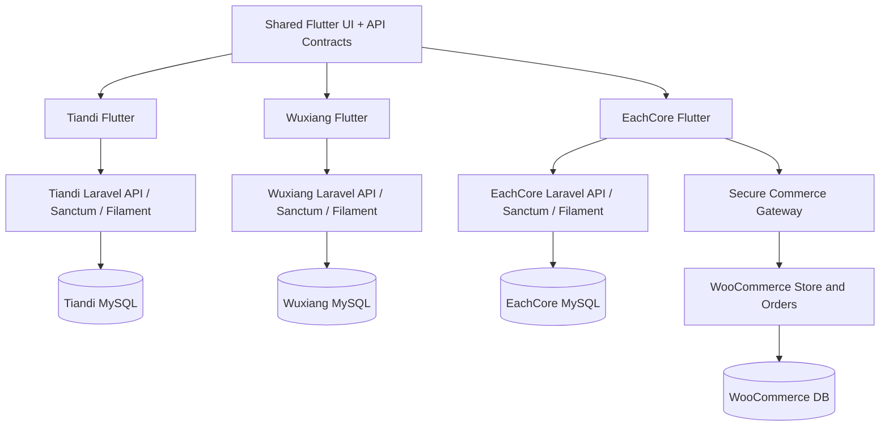
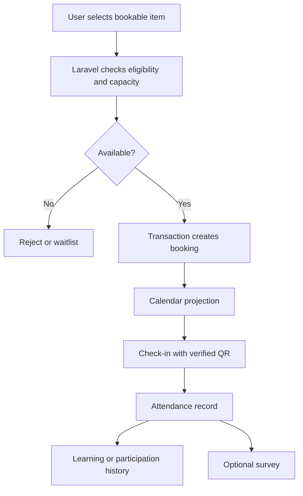
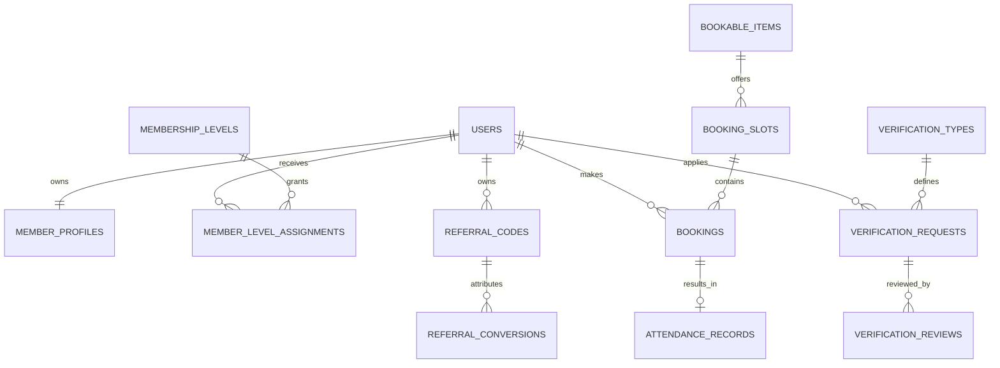
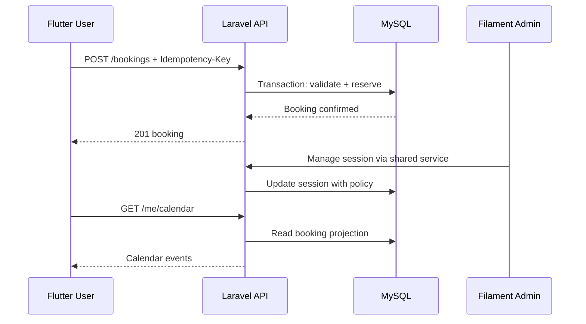
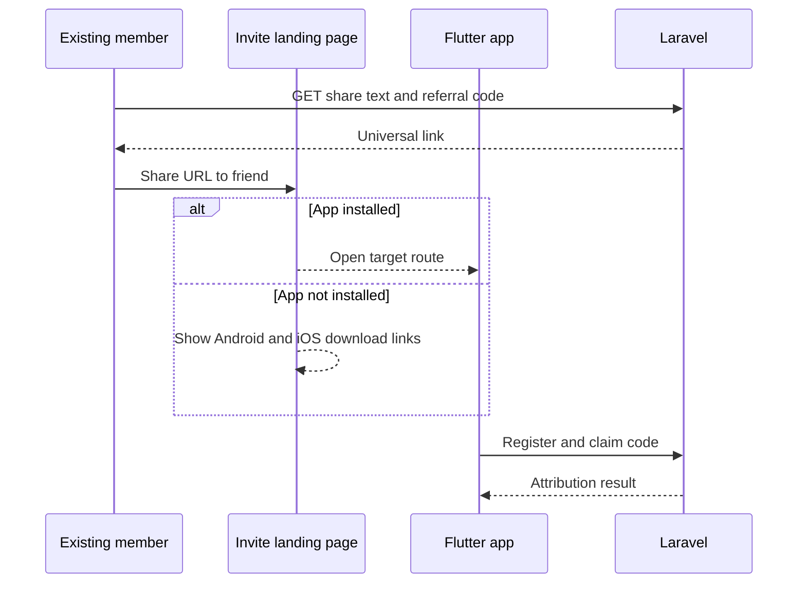

# 三大 App 共用模組功能需求規格書 v1.0

**日期**：2026-10-22　｜　**狀態**：需求基線草案／待逐項確認　｜　**依據**：三大 App 完整計畫 v8.0、使用者本輪確認事項。

> 本文件是可交給 Flutter、Laravel、Filament 開發者的功能需求與資料契約草案；未經實機驗證的設計標為「建議」，尚未經團體核定的制度標為「待確認」。三個 App 可重用程式碼、資料模型模式與 API 契約，但**不強制共用正式資料庫、會員帳號或部署環境**。

## 0. 不可違反的決策

1. **天帝教親和網**：Flutter Android/iOS + 獨立 Laravel API + Filament + MySQL；首個正式上架專案；先做教友、公告、活動報名、簽到。既有 v7.3 的分院、認證、QR、聊天、經典、功課、問卷等功能保留於需求池，逐期交付。
2. **無相氣學**：Flutter Android/iOS + 獨立 Laravel API + Filament + MySQL；學員、課程、活動、學習紀錄、推拿預約，後續可延伸煩惱專線與多人協同身分審核。
3. **EachCore／5qi.tw**：Flutter + Laravel/Filament 作為會員擴充、文章、社群、Tag、通知、預約、推薦等非交易功能主後端；**WooCommerce 暫為商品、庫存、購物車、結帳、訂單與交易權威來源**。不可把 WooCommerce 管理金鑰放進 App。
4. **兩個團體 App 的外部私下贊助**：不是 App 內收費／募款功能；最多提供可選的純資訊 CMS，**不建立贊助付款、贊助訂單、捐款收據、金流 API 或付款導流**。任何對外文案須依團體法律身分與用途經專業審核。宗教 App 的「認捐預約」是否只是非金錢意向登記，需另行定義，MVP 不設收款。
5. **EachCore IoT**：IoT 語音助理屬未來八大主力商品之一，但**現階段不開發硬體連線、裝置配對、韌體 OTA、裝置 API**。
6. **上架策略**：先共用基礎 PoC，第一個正式 App 為天帝教親和網；無相氣學與 EachCore 依資源另行排程。雙平台 Google Play 與 Apple App Store。
7. **技術原則**：Laravel Sanctum 優先採 opaque bearer token，不因文件出現 JWT 就強制導入 JWT；Filament 是後台，不直接當 Flutter API；Laravel Service/Policy 承擔授權。先採 REST，GraphQL 不是 MVP 必備。
8. **資料保護**：宗教身分、聯絡資料、健康相關偏好、學習歷程、審核證據皆依必要性與權限限制；敏感欄位不因管理員角色就全員可見。權限、VIP、身分認證為三套獨立概念。

## 1. 專案範圍、商業目標與交付順序

| 專案 | 使用者 | 核心旅程 | 初期營運／變現 | 本期不做 |
|---|---|---|---|---|
| 天帝教親和網 | 教友、訪客、分院工作者、活動管理者 | 加入→資料補全→必要資格審核→公告→活動報名→QR 簽到→參與歷程 | App 外自行接洽自願支持；App 最多中性資訊頁 | App 內贊助收款、複雜聊天平台、未確認的數位支付 |
| 無相氣學 | 學員、助教、講師、服務者、管理員 | 入會→課程/服務預約→日曆→簽到→學習紀錄→可選回饋 | App 外自行接洽自願支持；App 最多中性資訊頁 | App 內贊助收款、一次做完所有教務系統 |
| EachCore | 消費者、會員、VIP、品牌內容讀者、營運者 | 註冊→商品探索→購物車→結帳→訂單；另有文章、收藏、推薦 | 實體商品與創新產品銷售 | IoT 裝置連線、重寫 WooCommerce 交易核心 |

**EachCore 主力商品優先名錄**：① IoT 語音助理（未來含連線 App 的硬體商品）、② 圓形靜心帳、③ 創意能量貼紙、④ 限量能量氣功茶、⑤ 創意能量手機架、⑥ 創意能量眼罩、⑦ 創意能量盆栽、⑧ 養生食品。竹、木、藤一般選物為次要方向。所有能量、養生用語須避免未經證實的醫療療效宣稱；食品、植物、硬體各有不同上架合規檢查。

## 2. 模組編號、共用層次與交付矩陣

**共用層次**：L0 = Flutter UI/設計規範；L1 = Dart client／API contract；L2 = Laravel 可移植 Package/Service；L3 = 各 App 的專屬業務規則與資料。優先重用 L0–L2，不做跨 App 中央會員資料庫。

| ID | 模組 | 天帝教 MVP | 無相氣學 MVP | EachCore MVP | 共用層 |
|---|---|---|---|---|---|
| M01 | Member Profile | 基礎＋擴充 | 基礎＋擴充 | 基礎＋收件分離 | L0–L2 |
| M02 | Membership Level & Permissions | 角色＋會員等級結構 | 角色＋會員等級結構 | 角色＋VIP 結構 | L1–L2 |
| M03 | Identity Verification | 基本資格核實 | 基本資格核實 | 帳號驗證 | L1–L2、規則 L3 |
| M04 | Notification | 類別偏好＋站內 | 類別偏好＋站內 | 類別偏好＋站內 | L0–L2 |
| M05 | Featured Articles | 文章、分享、讚、留言 | 同左 | 品牌文章 | L0–L2 |
| M06 | Notice & News | 必做 | 必做 | 基礎公告 | L0–L2 |
| M07 | Log Management | 必做 | 必做 | 必做 | L1–L2 |
| M08 | Booking | 活動、課程、服務 | 課程、推拿、活動 | 活動/預購以交易整合為準 | L1–L2、規則 L3 |
| M09 | Calendar | 個人活動 | 個人課程／服務 | 活動／服務 | L0–L2 |
| M10 | Survey | 結構預留／可選 | 結構預留／可選 | 交易後評價需分清 | L1–L2 |
| M11 | Check-in | 活動／課程 | 活動／課程 | 後期 UI 隱藏 | L1–L2 |
| M12 | Personal Payment | 不做團體贊助付款 | 不做團體贊助付款 | WooCommerce 實體交易 | L1（抽象） |
| M13 | Marketing-Referral | 分享邀請＋歸因 | 分享邀請＋歸因 | 分享邀請＋歸因 | L0–L2 |
| M14 | Deep Link | 必做 | 必做 | 必做 | L0–L1 |
| M15 | Marketing | 簡易宣傳 | 簡易宣傳 | 商品／活動宣傳 | L1–L2 |
| M16 | Tag Intelligence | 先標籤基礎 | 先標籤基礎 | 內容標籤 | L1–L2 |
| M17 | URL Clicks / Analytics | 必要事件 | 必要事件 | 必要事件 | L1–L2 |
| M18 | Context Score | 後期 | 後期 | 後期 | L2 |
| M19 | Full-text Search & Bookmark | 公告搜尋／收藏 | 課程搜尋／收藏 | 商品與文章搜尋／收藏 | L0–L2 |
| M20 | File/Media + Rclone/Syncthing | 儲存基礎；同步後期 | 儲存基礎；同步後期 | 商品圖片由權威端管理 | L1–L2 |

> 「基礎」「結構預留」不等於首版必須建立所有 UI 或資料表；只有有真實業務流程且通過驗收的部分才進 MVP Migration。以下欄位是建議 schema，正式命名以 Migration 與 API OpenAPI 契約為準。

## M01｜Member Profile（優先詳細規格）

### 業務功能與狀態

完整個人資料分群；資料完整度、隱私、可編輯範圍、不同 App 專屬欄位。建議採用「草稿／有效／停用／撤銷」等明確狀態，任何狀態轉換必須在 Laravel 服務層檢查，不能只靠 Flutter 隱藏按鈕。新增與修改需記錄操作者、時間、原因，敏感欄位不得進入一般分析事件。

### Flutter 使用者畫面

個人首頁／基本資料／聯絡方式／地址／偏好／隱私／資料完整度。每頁必備載入、空資料、離線、權限不足、逾時、重試及提交中防連點狀態。表單顯示必填／選填與資料用途；不應一次要求所有個人資料。

### Filament 管理功能

Profiles Resource；欄位可見性、批次匯入審核、變更記錄。所有 Resource 的 List/Detail/Create/Edit/Action 皆需對應 Policy；大量異動提供預覽與操作日誌，審核操作禁止未授權者批次核准。

### 資料表與重要欄位（建議）

`users(id,email,phone,status); member_profiles(user_id,display_name,legal_name,birth_date,avatar_id,locale,timezone); member_contacts(user_id,type,value,verified_at); member_preferences(user_id,key,value); member_addresses(user_id,type,...); profile_field_definitions(app,code,type,sensitivity); profile_field_values(user_id,field_id,value_ciphertext)`。

建議通用欄位：`id`（ULID 或 bigint 擇一）、`created_at`、`updated_at`、必要的 `deleted_at`、`created_by`、`status`、`version`。不可對具有法規/稽核意義的紀錄直接硬刪；需依資料保留政策設定。

### 權限與安全

本人可編輯授權欄位；敏感資料按職責欄位級授權；客服不可任意讀取宗教/健康敏感資訊。服務端使用 Policy、FormRequest、交易與唯一索引；資料表外鍵約束不可由 UI 取代。需定義使用者停權、刪除帳號、隱私要求後的處理。

### API 草案

`GET/PATCH /api/v1/me/profile; GET /profile/schema; POST /me/avatar`。統一採 `/api/v1`、JSON、ISO-8601 時間、分頁 cursor/limit、錯誤格式含 error.code、error.message、error.fields。寫入端支援必要冪等鍵與速率限制，OpenAPI 是 Flutter Client 的契約來源。

### 模組關聯與三 App 差異

關聯：M02/M03/M04/M08/M13。

宗教：分院關聯與教友資料需分表；無相：學員經歷/專長與服務偏好；電商：收件地址與交易帳戶映射，不把 Woo 收件地址混入宗教 Profile。三個 App 共享介面/規則模板，但各自 Migration、資料與權限獨立，不能以跨 App 外鍵互相查詢會員。

### MVP 與後期驗收

能補齊必要資料且無權者無法查閱；後期動態欄位、歷史版次、批次匯入。驗收至少涵蓋正常流程、未授權、資料不存在、重複提交、併發、取消/撤銷、手機離線與資料回復；PASS 必須附 API 回應、畫面與資料庫證據。

## M02｜Membership Level & Permissions（優先詳細規格）

### 業務功能與狀態

角色/權限/VIP 三軸；VIP 有效期、升降級與可用待遇。建議採用「草稿／有效／停用／撤銷」等明確狀態，任何狀態轉換必須在 Laravel 服務層檢查，不能只靠 Flutter 隱藏按鈕。新增與修改需記錄操作者、時間、原因，敏感欄位不得進入一般分析事件。

### Flutter 使用者畫面

會員卡、目前等級、待遇說明；管理員功能按權限顯示。每頁必備載入、空資料、離線、權限不足、逾時、重試及提交中防連點狀態。表單顯示必填／選填與資料用途；不應一次要求所有個人資料。

### Filament 管理功能

Role/Permission/VIP Level Resource、會員等級變更稽核。所有 Resource 的 List/Detail/Create/Edit/Action 皆需對應 Policy；大量異動提供預覽與操作日誌，審核操作禁止未授權者批次核准。

### 資料表與重要欄位（建議）

`roles(id,slug); permissions(id,slug); model_has_roles; membership_levels(id,code,rank); member_level_assignments(user_id,level_id,starts_at,ends_at,reason)`。

建議通用欄位：`id`（ULID 或 bigint 擇一）、`created_at`、`updated_at`、必要的 `deleted_at`、`created_by`、`status`、`version`。不可對具有法規/稽核意義的紀錄直接硬刪；需依資料保留政策設定。

### 權限與安全

role 決定管理權；level 決定會員待遇；verification 不授權管理權；所有 API 用 Policy 判斷。服務端使用 Policy、FormRequest、交易與唯一索引；資料表外鍵約束不可由 UI 取代。需定義使用者停權、刪除帳號、隱私要求後的處理。

### API 草案

`GET /me/membership; GET /membership-levels; admin POST /members/{id}/levels`。統一採 `/api/v1`、JSON、ISO-8601 時間、分頁 cursor/limit、錯誤格式含 error.code、error.message、error.fields。寫入端支援必要冪等鍵與速率限制，OpenAPI 是 Flutter Client 的契約來源。

### 模組關聯與三 App 差異

關聯：M01/M03/M08/M15。

宗教：教友資格不是 VIP；無相：助教講師稱謂不等於後台角色；EachCore：VIP 可能依消費政策但不得直接賦管理權。三個 App 共享介面/規則模板，但各自 Migration、資料與權限獨立，不能以跨 App 外鍵互相查詢會員。

### MVP 與後期驗收

會員等級到期正確失效、角色提升必須授權；後期 VIP 自動升降級與權益規則。驗收至少涵蓋正常流程、未授權、資料不存在、重複提交、併發、取消/撤銷、手機離線與資料回復；PASS 必須附 API 回應、畫面與資料庫證據。

## M03｜Identity Verification（優先詳細規格）

### 業務功能與狀態

基本帳號核實；後期多維證據、多審核者、多階段、有效期、撤銷、專業徽章。建議採用「草稿／有效／停用／撤銷」等明確狀態，任何狀態轉換必須在 Laravel 服務層檢查，不能只靠 Flutter 隱藏按鈕。新增與修改需記錄操作者、時間、原因，敏感欄位不得進入一般分析事件。

### Flutter 使用者畫面

認證狀態／申請／補件／進度；不公開證據。每頁必備載入、空資料、離線、權限不足、逾時、重試及提交中防連點狀態。表單顯示必填／選填與資料用途；不應一次要求所有個人資料。

### Filament 管理功能

Verification Types、審核佇列、審核分派、理由、稽核與撤銷。所有 Resource 的 List/Detail/Create/Edit/Action 皆需對應 Policy；大量異動提供預覽與操作日誌，審核操作禁止未授權者批次核准。

### 資料表與重要欄位（建議）

`verification_types(id,code,requirements_json); verification_requests(id,user_id,type_id,status); verification_evidence(id,request_id,file_id); verification_reviews(id,request_id,reviewer_id,decision,comment); verified_badges(id,user_id,type_id,valid_until)`。

建議通用欄位：`id`（ULID 或 bigint 擇一）、`created_at`、`updated_at`、必要的 `deleted_at`、`created_by`、`status`、`version`。不可對具有法規/稽核意義的紀錄直接硬刪；需依資料保留政策設定。

### 權限與安全

申請人不得自審；審核者只看分派證據；多人審核規則在後端原子判定；撤銷立即失去徽章。服務端使用 Policy、FormRequest、交易與唯一索引；資料表外鍵約束不可由 UI 取代。需定義使用者停權、刪除帳號、隱私要求後的處理。

### API 草案

`POST /verifications; GET /me/verifications; POST /verifications/{id}/evidence; admin POST /reviews/{id}/decision`。統一採 `/api/v1`、JSON、ISO-8601 時間、分頁 cursor/limit、錯誤格式含 error.code、error.message、error.fields。寫入端支援必要冪等鍵與速率限制，OpenAPI 是 Flutter Client 的契約來源。

### 模組關聯與三 App 差異

關聯：M01/M02/M04/M20。

宗教：分院/教友多維協同；無相：學員、師資、專業資格多維協同；EachCore：初期 email/phone，後期專業大師/人才徽章，不能購買 VIP 取得。三個 App 共享介面/規則模板，但各自 Migration、資料與權限獨立，不能以跨 App 外鍵互相查詢會員。

### MVP 與後期驗收

MVP 基本資格核實與禁止自審；後期 N 人審核、衝突處理、到期、徽章公示與申訴。驗收至少涵蓋正常流程、未授權、資料不存在、重複提交、併發、取消/撤銷、手機離線與資料回復；PASS 必須附 API 回應、畫面與資料庫證據。

## M08｜Booking（優先詳細規格）

### 業務功能與狀態

通用預約外殼＋不同 booking_type 策略；容量、候補、衝突、取消、服務資源、時間區。建議採用「草稿／有效／停用／撤銷」等明確狀態，任何狀態轉換必須在 Laravel 服務層檢查，不能只靠 Flutter 隱藏按鈕。新增與修改需記錄操作者、時間、原因，敏感欄位不得進入一般分析事件。

### Flutter 使用者畫面

類型選擇、時段、確認、我的預約、取消與候補。每頁必備載入、空資料、離線、權限不足、逾時、重試及提交中防連點狀態。表單顯示必填／選填與資料用途；不應一次要求所有個人資料。

### Filament 管理功能

Booking Types/Slots/Resources/Registrations、衝突檢查、手動調整。所有 Resource 的 List/Detail/Create/Edit/Action 皆需對應 Policy；大量異動提供預覽與操作日誌，審核操作禁止未授權者批次核准。

### 資料表與重要欄位（建議）

`booking_types(id,code); bookable_items(id,type_id,title,capacity); booking_slots(id,item_id,starts_at,ends_at,resource_id); bookings(id,user_id,slot_id,status,idempotency_key); waitlist_entries(id,slot_id,user_id,position)`。

建議通用欄位：`id`（ULID 或 bigint 擇一）、`created_at`、`updated_at`、必要的 `deleted_at`、`created_by`、`status`、`version`。不可對具有法規/稽核意義的紀錄直接硬刪；需依資料保留政策設定。

### 權限與安全

本人看本人；活動負責人看所管場次；並發使用 transaction+unique index；不得超賣；不把認捐意向當收款。服務端使用 Policy、FormRequest、交易與唯一索引；資料表外鍵約束不可由 UI 取代。需定義使用者停權、刪除帳號、隱私要求後的處理。

### API 草案

`GET /bookables; GET /bookables/{id}/slots; POST /bookings; POST /bookings/{id}/cancel; GET /me/bookings`。統一採 `/api/v1`、JSON、ISO-8601 時間、分頁 cursor/limit、錯誤格式含 error.code、error.message、error.fields。寫入端支援必要冪等鍵與速率限制，OpenAPI 是 Flutter Client 的契約來源。

### 模組關聯與三 App 差異

關聯：M01/M02/M03/M04/M09/M10/M11/M12。

宗教：上課/活動/服務/煩惱專線；「認捐」先定義非金錢意向且 MVP 不付款；無相：上課/推拿/活動/煩惱專線；EachCore：預購/搶購交易由 Woo 訂單主導，不能另建平行訂單。三個 App 共享介面/規則模板，但各自 Migration、資料與權限獨立，不能以跨 App 外鍵互相查詢會員。

### MVP 與後期驗收

重複提交不重複預約、同時搶最後一位僅一成功、取消釋出名額；後期候補/週期性預約/服務者排班。驗收至少涵蓋正常流程、未授權、資料不存在、重複提交、併發、取消/撤銷、手機離線與資料回復；PASS 必須附 API 回應、畫面與資料庫證據。

## M09｜Calendar（優先詳細規格）

### 業務功能與狀態

由已確認預約與活動派生個人日曆；顯示不等於預約權威資料。建議採用「草稿／有效／停用／撤銷」等明確狀態，任何狀態轉換必須在 Laravel 服務層檢查，不能只靠 Flutter 隱藏按鈕。新增與修改需記錄操作者、時間、原因，敏感欄位不得進入一般分析事件。

### Flutter 使用者畫面

月／週／清單、日曆詳情、加入外部行事曆。每頁必備載入、空資料、離線、權限不足、逾時、重試及提交中防連點狀態。表單顯示必填／選填與資料用途；不應一次要求所有個人資料。

### Filament 管理功能

行事曆設定、事件類型、時區、取消同步檢查。所有 Resource 的 List/Detail/Create/Edit/Action 皆需對應 Policy；大量異動提供預覽與操作日誌，審核操作禁止未授權者批次核准。

### 資料表與重要欄位（建議）

`calendar_event_views（建議以 SQL view/API 投影而非重複寫表）; calendar_subscriptions(user_id,...)`。

建議通用欄位：`id`（ULID 或 bigint 擇一）、`created_at`、`updated_at`、必要的 `deleted_at`、`created_by`、`status`、`version`。不可對具有法規/稽核意義的紀錄直接硬刪；需依資料保留政策設定。

### 權限與安全

個人只見有權的事件；隱私事件只顯示安全標題；時區存 UTC 顯示本地。服務端使用 Policy、FormRequest、交易與唯一索引；資料表外鍵約束不可由 UI 取代。需定義使用者停權、刪除帳號、隱私要求後的處理。

### API 草案

`GET /me/calendar?from=&to=; GET /me/calendar/{id}; GET /me/calendar.ics`。統一採 `/api/v1`、JSON、ISO-8601 時間、分頁 cursor/limit、錯誤格式含 error.code、error.message、error.fields。寫入端支援必要冪等鍵與速率限制，OpenAPI 是 Flutter Client 的契約來源。

### 模組關聯與三 App 差異

關聯：M04/M08/M11。

宗教：教友活動；無相：課程、推拿；EachCore：活動、服務、預購提醒但商品訂單仍以 Woo 為準。三個 App 共享介面/規則模板，但各自 Migration、資料與權限獨立，不能以跨 App 外鍵互相查詢會員。

### MVP 與後期驗收

報名新增/取消即更新日曆、跨時區正確；後期外部雙向同步需另行評估。驗收至少涵蓋正常流程、未授權、資料不存在、重複提交、併發、取消/撤銷、手機離線與資料回復；PASS 必須附 API 回應、畫面與資料庫證據。

## M11｜Check-in（優先詳細規格）

### 業務功能與狀態

簽到需對應真實活動/課程；簽到紀錄與完成歷程分開；防重複與授權。建議採用「草稿／有效／停用／撤銷」等明確狀態，任何狀態轉換必須在 Laravel 服務層檢查，不能只靠 Flutter 隱藏按鈕。新增與修改需記錄操作者、時間、原因，敏感欄位不得進入一般分析事件。

### Flutter 使用者畫面

我的 QR/活動 QR、掃描、成功/失敗、出席歷程。每頁必備載入、空資料、離線、權限不足、逾時、重試及提交中防連點狀態。表單顯示必填／選填與資料用途；不應一次要求所有個人資料。

### Filament 管理功能

簽到站點、工作人員授權、補登與更正原因。所有 Resource 的 List/Detail/Create/Edit/Action 皆需對應 Policy；大量異動提供預覽與操作日誌，審核操作禁止未授權者批次核准。

### 資料表與重要欄位（建議）

`checkin_sessions(id,bookable_id,opens_at,closes_at); checkin_tokens(id,session_id,nonce_hash,expires_at); attendance_records(id,session_id,user_id,status,checked_at,method,operator_id)`。

建議通用欄位：`id`（ULID 或 bigint 擇一）、`created_at`、`updated_at`、必要的 `deleted_at`、`created_by`、`status`、`version`。不可對具有法規/稽核意義的紀錄直接硬刪；需依資料保留政策設定。

### 權限與安全

簽到 QR 必須有期限/伺服器驗證；補登需權限與稽核；不可憑靜態 QR 文字自行簽到。服務端使用 Policy、FormRequest、交易與唯一索引；資料表外鍵約束不可由 UI 取代。需定義使用者停權、刪除帳號、隱私要求後的處理。

### API 草案

`POST /checkins/verify; GET /me/attendance; admin POST /attendance/{id}/correct`。統一採 `/api/v1`、JSON、ISO-8601 時間、分頁 cursor/limit、錯誤格式含 error.code、error.message、error.fields。寫入端支援必要冪等鍵與速率限制，OpenAPI 是 Flutter Client 的契約來源。

### 模組關聯與三 App 差異

關聯：M01/M03/M08/M09/M10/M07。

宗教：活動/課程成個人參與歷程；無相：課程/活動成學習歷程；EachCore：首版不顯示，後期店家合作再啟用。三個 App 共享介面/規則模板，但各自 Migration、資料與權限獨立，不能以跨 App 外鍵互相查詢會員。

### MVP 與後期驗收

未報名者拒絕、過期 QR 拒絕、重複簽到冪等、補登有紀錄；後期離線掃描與跨店家。驗收至少涵蓋正常流程、未授權、資料不存在、重複提交、併發、取消/撤銷、手機離線與資料回復；PASS 必須附 API 回應、畫面與資料庫證據。

## M13｜Marketing-Referral（優先詳細規格）

### 業務功能與狀態

Refer a Friend、分享文案、推薦碼、歸因、轉換統計、防濫用。建議採用「草稿／有效／停用／撤銷」等明確狀態，任何狀態轉換必須在 Laravel 服務層檢查，不能只靠 Flutter 隱藏按鈕。新增與修改需記錄操作者、時間、原因，敏感欄位不得進入一般分析事件。

### Flutter 使用者畫面

固定 Refer a Friend 按鈕、分享預覽、推薦碼、邀請進度。每頁必備載入、空資料、離線、權限不足、逾時、重試及提交中防連點狀態。表單顯示必填／選填與資料用途；不應一次要求所有個人資料。

### Filament 管理功能

Campaigns、文案、有效期、來源、推薦關係、轉換漏斗、異常事件。所有 Resource 的 List/Detail/Create/Edit/Action 皆需對應 Policy；大量異動提供預覽與操作日誌，審核操作禁止未授權者批次核准。

### 資料表與重要欄位（建議）

`referral_campaigns(id,app,starts_at,ends_at); referral_codes(id,user_id,campaign_id,code); referral_clicks(id,code_id,occurred_at,utm_json); referral_conversions(id,code_id,invitee_user_id,converted_at)`。

建議通用欄位：`id`（ULID 或 bigint 擇一）、`created_at`、`updated_at`、必要的 `deleted_at`、`created_by`、`status`、`version`。不可對具有法規/稽核意義的紀錄直接硬刪；需依資料保留政策設定。

### 權限與安全

推薦關係後端驗證；禁止自我推薦與重複註冊刷量；原始 IP 最小化；不能默認給金錢獎勵。服務端使用 Policy、FormRequest、交易與唯一索引；資料表外鍵約束不可由 UI 取代。需定義使用者停權、刪除帳號、隱私要求後的處理。

### API 草案

`GET /referrals/share; GET /r/{code}; POST /referrals/claim; GET /me/referrals`。統一採 `/api/v1`、JSON、ISO-8601 時間、分頁 cursor/limit、錯誤格式含 error.code、error.message、error.fields。寫入端支援必要冪等鍵與速率限制，OpenAPI 是 Flutter Client 的契約來源。

### 模組關聯與三 App 差異

關聯：M01/M04/M14/M15/M17。

宗教：邀請朋友下載與參與；無相：邀請學員；EachCore：導向會員註冊或商品內容，購物獎勵另受交易規則。三個 App 共享介面/規則模板，但各自 Migration、資料與權限獨立，不能以跨 App 外鍵互相查詢會員。

### MVP 與後期驗收

已安裝 App 開指定頁；未安裝顯示 Web 雙平台下載頁；推薦碼可在註冊兌換；後期 deferred deep link 與反作弊。驗收至少涵蓋正常流程、未授權、資料不存在、重複提交、併發、取消/撤銷、手機離線與資料回復；PASS 必須附 API 回應、畫面與資料庫證據。

## M04｜Notification（完整模組規格）

**功能需求**：通知類別偏好、站內通知、推播權限、重要系統訊息與行銷訊息分開。必須區分必填與選填、公開與私人、一般與敏感資訊。所有列表支援分頁、排序、搜尋及無資料狀態；任何狀態改變需可追蹤。

**Flutter 畫面**：通知中心、通知偏好、裝置推播開關。統一 loading/error/empty/offline 樣式，必要時顯示未授權及登入逾期提示。

**Filament 管理**：類別與模板、發送排程、重試與失敗紀錄。操作按角色與 Policy 授權；建立、修改、下架、匯出均留必要日誌。

**資料欄位／關聯**：`notification_categories,notification_preferences,notifications,device_push_tokens`；統一 user_id、狀態、時間戳、外鍵與索引，敏感資料另做保護。與 Member Profile、權限、Notification、Log 的整合由 Laravel Service 層處理。

**API**：`GET/PATCH /me/notification-preferences; GET /me/notifications`；遵守 `/api/v1`、FormRequest、Policy、錯誤碼、分頁及速率限制。涉及推播與 Webhook 的操作採可重試、冪等設計。

**三 App 差異**：天帝教偏教友公告、活動與分院；無相偏課程、學員與服務；EachCore 偏品牌內容、商品與會員，WooCommerce 的交易資料不複製成第二套權威訂單。未啟用功能在 Flutter 隱藏入口，但服務端仍執行權限檢查。

**MVP／後期驗收**：MVP 可選擇類別且拒收行銷後不再推送；後期 FCM/APNs 批次推送。每個驗收項須提供 Flutter 畫面、API 回應、Filament 管理結果、權限拒絕案例與資料庫查核證據。

## M05｜Featured Articles（完整模組規格）

**功能需求**：精選文章、分享、按讚、可見按讚者名單、簡易留言板與檢舉。必須區分必填與選填、公開與私人、一般與敏感資訊。所有列表支援分頁、排序、搜尋及無資料狀態；任何狀態改變需可追蹤。

**Flutter 畫面**：文章列表/詳情、按讚名單、留言、分享。統一 loading/error/empty/offline 樣式，必要時顯示未授權及登入逾期提示。

**Filament 管理**：文章編輯、精選排序、留言審核、隱藏/下架。操作按角色與 Policy 授權；建立、修改、下架、匯出均留必要日誌。

**資料欄位／關聯**：`articles,article_likes,article_comments,comment_reports`；統一 user_id、狀態、時間戳、外鍵與索引，敏感資料另做保護。與 Member Profile、權限、Notification、Log 的整合由 Laravel Service 層處理。

**API**：`GET /articles; POST/DELETE /articles/{id}/likes; GET /articles/{id}/likes; POST /articles/{id}/comments`；遵守 `/api/v1`、FormRequest、Policy、錯誤碼、分頁及速率限制。涉及推播與 Webhook 的操作採可重試、冪等設計。

**三 App 差異**：天帝教偏教友公告、活動與分院；無相偏課程、學員與服務；EachCore 偏品牌內容、商品與會員，WooCommerce 的交易資料不複製成第二套權威訂單。未啟用功能在 Flutter 隱藏入口，但服務端仍執行權限檢查。

**MVP／後期驗收**：MVP 讚可取消、按讚名單遵守個資可見設定、留言可審核；後期巢狀討論。每個驗收項須提供 Flutter 畫面、API 回應、Filament 管理結果、權限拒絕案例與資料庫查核證據。

## M06｜Notice & News（完整模組規格）

**功能需求**：公告分類、受眾、置頂、開始/截止、草稿與發布。必須區分必填與選填、公開與私人、一般與敏感資訊。所有列表支援分頁、排序、搜尋及無資料狀態；任何狀態改變需可追蹤。

**Flutter 畫面**：公告清單/詳情/已讀。統一 loading/error/empty/offline 樣式，必要時顯示未授權及登入逾期提示。

**Filament 管理**：公告排程、受眾設定、版本與撤稿。操作按角色與 Policy 授權；建立、修改、下架、匯出均留必要日誌。

**資料欄位／關聯**：`notices,notice_categories,notice_audiences,notice_reads`；統一 user_id、狀態、時間戳、外鍵與索引，敏感資料另做保護。與 Member Profile、權限、Notification、Log 的整合由 Laravel Service 層處理。

**API**：`GET /notices; GET /notices/{id}; POST /notices/{id}/read`；遵守 `/api/v1`、FormRequest、Policy、錯誤碼、分頁及速率限制。涉及推播與 Webhook 的操作採可重試、冪等設計。

**三 App 差異**：天帝教偏教友公告、活動與分院；無相偏課程、學員與服務；EachCore 偏品牌內容、商品與會員，WooCommerce 的交易資料不複製成第二套權威訂單。未啟用功能在 Flutter 隱藏入口，但服務端仍執行權限檢查。

**MVP／後期驗收**：MVP 受眾與發布時間有效；後期多語及精準通知。每個驗收項須提供 Flutter 畫面、API 回應、Filament 管理結果、權限拒絕案例與資料庫查核證據。

## M07｜Log Management（完整模組規格）

**功能需求**：安全登入、後台異動、認證決策、預約、簽到、API 錯誤的最小稽核。必須區分必填與選填、公開與私人、一般與敏感資訊。所有列表支援分頁、排序、搜尋及無資料狀態；任何狀態改變需可追蹤。

**Flutter 畫面**：本人帳號安全事件（可選）。統一 loading/error/empty/offline 樣式，必要時顯示未授權及登入逾期提示。

**Filament 管理**：Audit Log 檢索、保留期、權限。操作按角色與 Policy 授權；建立、修改、下架、匯出均留必要日誌。

**資料欄位／關聯**：`audit_logs,security_events,application_errors`；統一 user_id、狀態、時間戳、外鍵與索引，敏感資料另做保護。與 Member Profile、權限、Notification、Log 的整合由 Laravel Service 層處理。

**API**：`GET /me/security-events; admin GET /audit-logs`；遵守 `/api/v1`、FormRequest、Policy、錯誤碼、分頁及速率限制。涉及推播與 Webhook 的操作採可重試、冪等設計。

**三 App 差異**：天帝教偏教友公告、活動與分院；無相偏課程、學員與服務；EachCore 偏品牌內容、商品與會員，WooCommerce 的交易資料不複製成第二套權威訂單。未啟用功能在 Flutter 隱藏入口，但服務端仍執行權限檢查。

**MVP／後期驗收**：MVP 不寫入密碼/token/證據明文；後期集中日誌。每個驗收項須提供 Flutter 畫面、API 回應、Filament 管理結果、權限拒絕案例與資料庫查核證據。

## M10｜Survey（完整模組規格）

**功能需求**：依完成事件選擇性啟用問卷、評分與回饋。必須區分必填與選填、公開與私人、一般與敏感資訊。所有列表支援分頁、排序、搜尋及無資料狀態；任何狀態改變需可追蹤。

**Flutter 畫面**：待填問卷、跳過、填答、回顧。統一 loading/error/empty/offline 樣式，必要時顯示未授權及登入逾期提示。

**Filament 管理**：問卷題庫、啟用條件、匿名設定、匯總。操作按角色與 Policy 授權；建立、修改、下架、匯出均留必要日誌。

**資料欄位／關聯**：`surveys,survey_questions,survey_assignments,survey_responses`；統一 user_id、狀態、時間戳、外鍵與索引，敏感資料另做保護。與 Member Profile、權限、Notification、Log 的整合由 Laravel Service 層處理。

**API**：`GET /me/surveys; POST /surveys/{id}/responses`；遵守 `/api/v1`、FormRequest、Policy、錯誤碼、分頁及速率限制。涉及推播與 Webhook 的操作採可重試、冪等設計。

**三 App 差異**：天帝教偏教友公告、活動與分院；無相偏課程、學員與服務；EachCore 偏品牌內容、商品與會員，WooCommerce 的交易資料不複製成第二套權威訂單。未啟用功能在 Flutter 隱藏入口，但服務端仍執行權限檢查。

**MVP／後期驗收**：MVP 問卷可不填、不阻擋學習歷程；後期分支題與統計。每個驗收項須提供 Flutter 畫面、API 回應、Filament 管理結果、權限拒絕案例與資料庫查核證據。

## M12｜Personal Payment（完整模組規格）

**功能需求**：僅保留可辨別「訂單支付」「實體服務」「非交易意向」的領域概念；兩團體贊助絕不導入。必須區分必填與選填、公開與私人、一般與敏感資訊。所有列表支援分頁、排序、搜尋及無資料狀態；任何狀態改變需可追蹤。

**Flutter 畫面**：EachCore 查看 Woo 訂單；團體 App 不設贊助付款。統一 loading/error/empty/offline 樣式，必要時顯示未授權及登入逾期提示。

**Filament 管理**：EachCore 商品訂單在 Woo 後台；Filament 僅讀取必要狀態。操作按角色與 Policy 授權；建立、修改、下架、匯出均留必要日誌。

**資料欄位／關聯**：`commerce_order_mappings（必要時）, payment_status_projection（唯讀）；團體不建立 donation/payment 表`；統一 user_id、狀態、時間戳、外鍵與索引，敏感資料另做保護。與 Member Profile、權限、Notification、Log 的整合由 Laravel Service 層處理。

**API**：`GET /commerce/orders（由安全 Gateway）；不提供團體贊助付款 API`；遵守 `/api/v1`、FormRequest、Policy、錯誤碼、分頁及速率限制。涉及推播與 Webhook 的操作採可重試、冪等設計。

**三 App 差異**：天帝教偏教友公告、活動與分院；無相偏課程、學員與服務；EachCore 偏品牌內容、商品與會員，WooCommerce 的交易資料不複製成第二套權威訂單。未啟用功能在 Flutter 隱藏入口，但服務端仍執行權限檢查。

**MVP／後期驗收**：MVP EachCore 真實交易在 Woo；團體無贊助付款入口；後期逐一核對平台支付規範。每個驗收項須提供 Flutter 畫面、API 回應、Filament 管理結果、權限拒絕案例與資料庫查核證據。

## M14｜Deep Link（完整模組規格）

**功能需求**：Android App Links/iOS Universal Links；未安裝導 Web 下載選擇頁；延遲深連結另評估。必須區分必填與選填、公開與私人、一般與敏感資訊。所有列表支援分頁、排序、搜尋及無資料狀態；任何狀態改變需可追蹤。

**Flutter 畫面**：路由解析、錯誤 fallback、平台下載頁。統一 loading/error/empty/offline 樣式，必要時顯示未授權及登入逾期提示。

**Filament 管理**：可管理連結路由、活動碼、落地頁文案。操作按角色與 Policy 授權；建立、修改、下架、匯出均留必要日誌。

**資料欄位／關聯**：`deep_link_routes,landing_pages`；統一 user_id、狀態、時間戳、外鍵與索引，敏感資料另做保護。與 Member Profile、權限、Notification、Log 的整合由 Laravel Service 層處理。

**API**：`GET /links/{slug}; Web GET /invite/{code}`；遵守 `/api/v1`、FormRequest、Policy、錯誤碼、分頁及速率限制。涉及推播與 Webhook 的操作採可重試、冪等設計。

**三 App 差異**：天帝教偏教友公告、活動與分院；無相偏課程、學員與服務；EachCore 偏品牌內容、商品與會員，WooCommerce 的交易資料不複製成第二套權威訂單。未啟用功能在 Flutter 隱藏入口，但服務端仍執行權限檢查。

**MVP／後期驗收**：MVP 安裝/未安裝兩種路徑通過；不採已停用 Firebase Dynamic Links。每個驗收項須提供 Flutter 畫面、API 回應、Filament 管理結果、權限拒絕案例與資料庫查核證據。

## M15｜Marketing（完整模組規格）

**功能需求**：簡單 Banner、宣傳活動、內容曝光與基本轉換統計。必須區分必填與選填、公開與私人、一般與敏感資訊。所有列表支援分頁、排序、搜尋及無資料狀態；任何狀態改變需可追蹤。

**Flutter 畫面**：活動橫幅與專區。統一 loading/error/empty/offline 樣式，必要時顯示未授權及登入逾期提示。

**Filament 管理**：Campaigns/Banners/受眾/時效/成效。操作按角色與 Policy 授權；建立、修改、下架、匯出均留必要日誌。

**資料欄位／關聯**：`marketing_campaigns,marketing_assets,marketing_impressions`；統一 user_id、狀態、時間戳、外鍵與索引，敏感資料另做保護。與 Member Profile、權限、Notification、Log 的整合由 Laravel Service 層處理。

**API**：`GET /campaigns; POST /analytics/events`；遵守 `/api/v1`、FormRequest、Policy、錯誤碼、分頁及速率限制。涉及推播與 Webhook 的操作採可重試、冪等設計。

**三 App 差異**：天帝教偏教友公告、活動與分院；無相偏課程、學員與服務；EachCore 偏品牌內容、商品與會員，WooCommerce 的交易資料不複製成第二套權威訂單。未啟用功能在 Flutter 隱藏入口，但服務端仍執行權限檢查。

**MVP／後期驗收**：MVP 只做少量人工活動；不做複雜自動化。每個驗收項須提供 Flutter 畫面、API 回應、Filament 管理結果、權限拒絕案例與資料庫查核證據。

## M16｜Tag Intelligence（完整模組規格）

**功能需求**：標籤分類、同義詞、別名、標籤權限；智慧推薦延後。必須區分必填與選填、公開與私人、一般與敏感資訊。所有列表支援分頁、排序、搜尋及無資料狀態；任何狀態改變需可追蹤。

**Flutter 畫面**：標籤選擇、標籤瀏覽。統一 loading/error/empty/offline 樣式，必要時顯示未授權及登入逾期提示。

**Filament 管理**：Tag/Taxonomy/合併。操作按角色與 Policy 授權；建立、修改、下架、匯出均留必要日誌。

**資料欄位／關聯**：`tags,taggables,tag_aliases`；統一 user_id、狀態、時間戳、外鍵與索引，敏感資料另做保護。與 Member Profile、權限、Notification、Log 的整合由 Laravel Service 層處理。

**API**：`GET /tags; GET /contents?tag=`；遵守 `/api/v1`、FormRequest、Policy、錯誤碼、分頁及速率限制。涉及推播與 Webhook 的操作採可重試、冪等設計。

**三 App 差異**：天帝教偏教友公告、活動與分院；無相偏課程、學員與服務；EachCore 偏品牌內容、商品與會員，WooCommerce 的交易資料不複製成第二套權威訂單。未啟用功能在 Flutter 隱藏入口，但服務端仍執行權限檢查。

**MVP／後期驗收**：MVP 人工標籤；後期推薦與標籤品質分數。每個驗收項須提供 Flutter 畫面、API 回應、Filament 管理結果、權限拒絕案例與資料庫查核證據。

## M17｜URL Clicks & Analytics（完整模組規格）

**功能需求**：最小事件追蹤，區分點擊與實際轉換，資料保留。必須區分必填與選填、公開與私人、一般與敏感資訊。所有列表支援分頁、排序、搜尋及無資料狀態；任何狀態改變需可追蹤。

**Flutter 畫面**：不展示隱私追蹤細節。統一 loading/error/empty/offline 樣式，必要時顯示未授權及登入逾期提示。

**Filament 管理**：事件查詢、匿名彙總。操作按角色與 Policy 授權；建立、修改、下架、匯出均留必要日誌。

**資料欄位／關聯**：`analytics_events,tracked_links`；統一 user_id、狀態、時間戳、外鍵與索引，敏感資料另做保護。與 Member Profile、權限、Notification、Log 的整合由 Laravel Service 層處理。

**API**：`POST /analytics/events; GET /r/{code}`；遵守 `/api/v1`、FormRequest、Policy、錯誤碼、分頁及速率限制。涉及推播與 Webhook 的操作採可重試、冪等設計。

**三 App 差異**：天帝教偏教友公告、活動與分院；無相偏課程、學員與服務；EachCore 偏品牌內容、商品與會員，WooCommerce 的交易資料不複製成第二套權威訂單。未啟用功能在 Flutter 隱藏入口，但服務端仍執行權限檢查。

**MVP／後期驗收**：MVP 匿名/必要資料、拒絕過度追蹤；後期漏斗分析。每個驗收項須提供 Flutter 畫面、API 回應、Filament 管理結果、權限拒絕案例與資料庫查核證據。

## M18｜Context Score（完整模組規格）

**功能需求**：可解釋、可版本化的內容分數，不以不透明 AI 分數直接裁決會員。必須區分必填與選填、公開與私人、一般與敏感資訊。所有列表支援分頁、排序、搜尋及無資料狀態；任何狀態改變需可追蹤。

**Flutter 畫面**：內容推薦標示（後期）。統一 loading/error/empty/offline 樣式，必要時顯示未授權及登入逾期提示。

**Filament 管理**：規則權重、試算、版本。操作按角色與 Policy 授權；建立、修改、下架、匯出均留必要日誌。

**資料欄位／關聯**：`score_rules,content_scores,score_versions`；統一 user_id、狀態、時間戳、外鍵與索引，敏感資料另做保護。與 Member Profile、權限、Notification、Log 的整合由 Laravel Service 層處理。

**API**：`GET /content/{id}/score`；遵守 `/api/v1`、FormRequest、Policy、錯誤碼、分頁及速率限制。涉及推播與 Webhook 的操作採可重試、冪等設計。

**三 App 差異**：天帝教偏教友公告、活動與分院；無相偏課程、學員與服務；EachCore 偏品牌內容、商品與會員，WooCommerce 的交易資料不複製成第二套權威訂單。未啟用功能在 Flutter 隱藏入口，但服務端仍執行權限檢查。

**MVP／後期驗收**：MVP 不強制上線；後期可回溯重算。每個驗收項須提供 Flutter 畫面、API 回應、Filament 管理結果、權限拒絕案例與資料庫查核證據。

## M19｜Search & Bookmark（完整模組規格）

**功能需求**：全文檢索、內容收藏、權限過濾。必須區分必填與選填、公開與私人、一般與敏感資訊。所有列表支援分頁、排序、搜尋及無資料狀態；任何狀態改變需可追蹤。

**Flutter 畫面**：搜尋結果、我的收藏。統一 loading/error/empty/offline 樣式，必要時顯示未授權及登入逾期提示。

**Filament 管理**：索引設定、失效收藏處理。操作按角色與 Policy 授權；建立、修改、下架、匯出均留必要日誌。

**資料欄位／關聯**：`bookmarks,search_index_metadata`；統一 user_id、狀態、時間戳、外鍵與索引，敏感資料另做保護。與 Member Profile、權限、Notification、Log 的整合由 Laravel Service 層處理。

**API**：`GET /search; POST/DELETE /bookmarks`；遵守 `/api/v1`、FormRequest、Policy、錯誤碼、分頁及速率限制。涉及推播與 Webhook 的操作採可重試、冪等設計。

**三 App 差異**：天帝教偏教友公告、活動與分院；無相偏課程、學員與服務；EachCore 偏品牌內容、商品與會員，WooCommerce 的交易資料不複製成第二套權威訂單。未啟用功能在 Flutter 隱藏入口，但服務端仍執行權限檢查。

**MVP／後期驗收**：MVP 資料庫搜尋+收藏；後期 Scout/外部引擎。每個驗收項須提供 Flutter 畫面、API 回應、Filament 管理結果、權限拒絕案例與資料庫查核證據。

## M20｜Files & Media / Rclone/Syncthing（完整模組規格）

**功能需求**：Laravel Storage、檔案權限、病毒與格式檢查；備份同步是維運而非會員共享資料。必須區分必填與選填、公開與私人、一般與敏感資訊。所有列表支援分頁、排序、搜尋及無資料狀態；任何狀態改變需可追蹤。

**Flutter 畫面**：頭像/附件上傳。統一 loading/error/empty/offline 樣式，必要時顯示未授權及登入逾期提示。

**Filament 管理**：媒體庫、檔案可見性、保留政策。操作按角色與 Policy 授權；建立、修改、下架、匯出均留必要日誌。

**資料欄位／關聯**：`media_files,media_attachments`；統一 user_id、狀態、時間戳、外鍵與索引，敏感資料另做保護。與 Member Profile、權限、Notification、Log 的整合由 Laravel Service 層處理。

**API**：`POST /uploads; GET /files/{id}`；遵守 `/api/v1`、FormRequest、Policy、錯誤碼、分頁及速率限制。涉及推播與 Webhook 的操作採可重試、冪等設計。

**三 App 差異**：天帝教偏教友公告、活動與分院；無相偏課程、學員與服務；EachCore 偏品牌內容、商品與會員，WooCommerce 的交易資料不複製成第二套權威訂單。未啟用功能在 Flutter 隱藏入口，但服務端仍執行權限檢查。

**MVP／後期驗收**：MVP 私有檔不可用永久公開 URL；後期備份同步與大型媒體處理。每個驗收項須提供 Flutter 畫面、API 回應、Filament 管理結果、權限拒絕案例與資料庫查核證據。

## 3. 跨模組整合契約

### 3.1 會員、等級、認證與專業徽章

- `users` 是登入主體；`member_profiles` 是資料；`membership_levels` 是待遇；`roles/permissions` 是操作權；`verification_requests` 是核實流程；`verified_badges` 是可公開的已核實聲明。五者不可共用單一 `status` 欄位。
- 認證成功不能自動給管理員權限；VIP 購買不能自動給專業徽章。徽章顯示需具可撤銷、有效期、發證來源與申訴流程。
- 宗教與無相的多維協同認證：MVP 先完成一個受控類型與單次審核流程，後期依實際審核章程設計多審核者 quorum、利益衝突迴避、覆核及申訴。

### 3.2 預約、日曆、簽到、歷程、問卷

1. 管理員建立活動／課程／服務與場次；每個場次有時間、名額、地點、可報名資格。
2. 使用者提交 Booking，服務端交易檢查資格、時段衝突、容量、重複預約與截止時間。
3. Booking 成功後，Calendar 以投影顯示；取消或改期即反映，不維護另一套獨立「日曆權威訂單」。
4. Check-in 依活動、會員與可驗證憑證建立 attendance；**預約成功不等於實際出席**。
5. Learning/Participation History 由完成/簽到證據形成，可標註補登與撤銷；Survey 是選填，不填不應取消既有出席。
6. 通知可按使用者偏好派送，但與安全有關的必要系統訊息需另行定義；不能把所有訊息當行銷推播。

### 3.3 Referral 與 Deep Link

`share button → /invite/{code} → Android App Links/iOS Universal Links → app target page`；未安裝時進 Web landing page 讓使用者選 Google Play／App Store。完成註冊後用有效推薦碼建立 `referral_conversions`；單一新帳號只能歸因一次。MVP 不保證跨安裝過程自動保存參數；提供註冊頁輸入推薦碼作可靠 fallback。

### 3.4 EachCore 交易邊界

- Flutter 商品顯示與購物車可走安全 Store API 或自有 Gateway，依 WooCommerce 正式 API 支援情況實測。
- WooCommerce 為商品 SKU、價格、庫存、購物車、訂單、付款、退款的權威資料；Laravel 只保存必要映射與非交易功能，不另建可修改金額的平行訂單。
- Laravel 會員與 WooCommerce customer 需明確一對一映射、錯誤復原與帳號合併規則；未完成此 PoC 前不承諾跨後端單一登入已可用。
- 電商「預購／搶購」屬商品交易；若涉及付款、限購、庫存，應由 WooCommerce 商品/訂單規則處理，不使用一般 Booking 當第二套交易引擎。

### 3.5 App 外支持資訊法律邊界

天帝教與無相若需要在 App 顯示團體發展資訊，僅使用一般 CMS 文字內容；不提供「立即贊助」、金額輸入、付款方式、QR 收款、外部付款導流、贊助交易統計或收據功能。此規格不構成法律意見，對外文案需由有權團體與法律專業者確認。一般 Booking 的「認捐」若無法確認是否涉及資金募集，MVP 不實作該類型。

## 4. 第一個正式 App：天帝教親和網的資料庫與頁面藍圖

### 4.1 MVP Flutter 頁面

| Route | 畫面 | 模組 | 完成條件 |
|---|---|---|---|
| `/auth/login` | 登入／忘記密碼 | Auth | 可登入、登出、撤銷 Token |
| `/home` | 首頁／公告摘要 | M06 | 依公開/會員受眾顯示 |
| `/profile` | 我的詳細資料 | M01 | 分群編輯、隱私可控 |
| `/membership` | 等級／資格狀態 | M02/M03 | 不混淆角色與認證 |
| `/notices` | 公告列表／詳情 | M06 | 分類、置頂、有效期間 |
| `/events` | 活動／課程列表 | M08 | 名額與報名資格正確 |
| `/events/:id` | 報名／取消 | M08 | 重複與併發防護 |
| `/calendar` | 個人行事曆 | M09 | 與報名狀態一致 |
| `/checkin` | 活動 QR／簽到 | M11 | 過期/重複/未授權拒絕 |
| `/history` | 個人參與歷程 | M11 | 不把報名當出席 |
| `/articles` | 精選文章互動 | M05 | 讚、名單、留言、分享 |
| `/notifications` | 通知與偏好 | M04 | 使用者選類別 |
| `/invite` | Refer a Friend | M13/M14 | 分享與落地頁有效 |
| `/settings` | 隱私、帳號刪除 | M01/Auth | 符合商店政策 |

### 4.2 MVP Filament Resource

`MemberResource`, `RoleResource`, `MembershipLevelResource`, `VerificationRequestResource`（簡版）, `NoticeResource`, `ArticleResource`, `EventResource`, `BookingResource`, `CheckinSessionResource`, `AttendanceResource`, `NotificationCategoryResource`, `ReferralCampaignResource`, `AuditLogResource`（唯讀）。Resource 只是管理 UI；權限與業務流程必須落在 Laravel Service/Policy。

### 4.3 MVP 建表順序

1. `users`, `member_profiles`, `member_contacts`, `member_preferences`。
2. `roles`, `permissions`, `membership_levels`, `member_level_assignments`。
3. `verification_types`, `verification_requests`（證據表只在真有必要時導入）。
4. `notices`, `articles`, `article_likes`, `article_comments`。
5. `bookable_items`, `booking_slots`, `bookings`, `checkin_sessions`, `attendance_records`。
6. `notification_categories`, `notification_preferences`, `notifications`。
7. `referral_campaigns`, `referral_codes`, `referral_conversions`。
8. `audit_logs` 與必要索引、唯一約束、測試種子資料。

**重要**：`bookings(user_id,slot_id)` 依取消後重報規則設計唯一性；`attendance_records(session_id,user_id)` 防重複；`referral_conversions(invitee_user_id)` 防多重歸因；`member_level_assignments` 不允許同時存在互斥有效等級。MySQL 時間欄位使用 UTC；所有列表查詢需要可用索引。

## 5. 各 App 專屬規格與驗收

### 5.1 天帝教親和網

**定位**：教友團體聯繫、公告、課程、活動、簽到、個人參與歷程；原始需求還包括分院申請、教友認證、個人 QR、經典、功課、聊天、問卷。後者按實際制度與資源分期，不視為取消。

**Profile**：基本資料、聯絡方式、隱私、所屬分院關係、教友資格（由獨立認證表核實）；分院欄位與個人宗教相關資訊不可預設公開。

**會員權限**：訪客、一般會員、活動工作者、分院管理者、系統管理員等僅為角色建議；實際角色名稱、分院管理權與可審核者名單需團體核定。VIP 不是宗教身分。

**認證**：初期採必要的簡單核實；未來多條件、多審核者，審核者必須可追蹤。認證狀態不得公開暴露個人證據。

**預約**：上課、活動、服務、煩惱專線可共用預約外殼，實際時段、名額、保密性各自配置；「認捐」類型暫不啟用，直到確認其非交易意向性質與合規邊界。

**學習／參與歷程**：活動簽到後產生可追溯 attendance；補登/撤銷需審核。問卷可跳過。公告與文章具不同發布、互動規則。

**MVP 驗收**：新教友註冊→個資編輯→查看公告→活動報名→日曆→QR 簽到→參與歷程；非授權分院管理者不得看到他院名單；無 App 內贊助金流或付款導流。

### 5.2 無相氣學

**定位**：學員、課程、活動、學習歷程、推拿服務與煩惱專線預約；管理端服務助教、講師、活動負責人及服務者。

**Profile**：學員基本資料、聯絡、學習偏好、課程關聯、服務預約所需的最小必要資訊；任何健康相關資訊應與一般會員資料隔離、限制存取與保留。

**會員等級／稱謂／角色**：VIP、學員程度、助教/講師稱謂、管理員權限為不同維度；不因稱謂自動賦管理權。若參考既有教室系統的 title_level 設計，需確認是否適用本 App，不直接照搬。

**認證**：後期可支援學員程度、師資、專業服務資格等多維協同審核；專業標記需證據、核發者與撤銷。

**預約**：上課是團體名額；推拿/煩惱專線通常是服務者時段互斥；活動有報名/候補；不能用同一個 capacity 規則覆蓋全部。取消截止、缺席、改期、服務保密另定。

**歷程**：課程報名與實際簽到分離；學習歷程可連結課程、梯次、出席、學習紀錄與可選回饋。問卷不應強制完成。

**MVP 驗收**：學員註冊→課程查看→報名→日曆→簽到→歷程；推拿預約的時段互斥測試；兩位學員同時搶最後名額僅一人成功；無 App 內贊助收款。

### 5.3 EachCore 電商

**定位**：品牌商品銷售與生活圈；八大主力商品以產品研發／銷售路線分階段上架，不能假定每項已有可販售庫存。IoT 語音助理未來含硬體連線 App，但目前僅作商品與研發規劃。

**Profile**：會員資料、地址、行銷偏好、VIP、收藏、內容互動、訂單對照；WooCommerce customer ID 與 Laravel user ID 映射，不以手機直接查詢管理 API。

**認證**：MVP 只做基本帳號驗證；未來專業大師/人才需獨立認證流程，帳號旁顯示經核實 Icon，不得因購買 VIP 或付費自動取得權威標章。

**Booking**：活動/服務可用 Laravel Booking；預購/搶購與實體商品付款由 WooCommerce 商品與訂單控制。個人日曆可顯示活動或預購提醒，但不成為訂單權威來源。

**支付**：WooCommerce 負責結帳、金流、庫存、退款、交易紀錄；Laravel/Filament 負責非交易業務。實體商品、食品、茶品、盆栽、硬體產品各需合規、物流與退換貨規則。

**MVP 驗收**：商品瀏覽→購物車→結帳→Woo 訂單→App 查詢訂單；商品價格由服務端計算，修改客戶端價格無效；Webhook 重送不重複產生業務結果；**不要求 IoT 硬體連線**。

## 6. 核心 Mermaid 架構與流程（原始碼可供文件系統渲染）

### 6.1 三 App 共用架構

### 6.2 預約與簽到流程

### 6.3 會員、認證、預約核心 ER

### 6.4 Flutter 與 Filament 操作順序

### 6.5 推薦好友與下載頁

## 7. 技術落地、開發分工與安全基線

- **Flutter**：Riverpod 或 Bloc 擇一；Dio API Client；go_router；flutter_secure_storage 儲存適當憑證；app_links 處理平台深連結；share_plus 分享。不要同時引入兩套狀態管理當標準。
- **Laravel**：Sanctum、Eloquent、Policies、FormRequest、Notifications、Filesystem、Queues（只有實際需要才開）；Spatie Permission 適合細權限，Tags 適合標籤；Scout Database Engine 先作全文搜尋候選。實際版本、License、維護狀態需在 PoC 鎖版。
- **Filament**：Resource 僅提供管理畫面；所有權限與寫入規則透過 Laravel Service/Policy，不能在 Filament Form 中另寫一套不同的 Booking 規則。
- **MySQL**：Migration、唯一索引、外鍵、交易與備份還原；敏感欄位加密與保留政策；不要把不同 App 使用者的宗教/學習/購物資料匯總成單一全域 Profile。
- **部署**：三個 App 可獨立後端、DB、憑證與環境；EachCore WooCommerce 維持交易獨立性。測試資料與正式資料隔離，Laravel Boost/Claude Code 只在開發環境使用。
- **API**：REST/OpenAPI、`/api/v1`、一致錯誤碼、pagination、idempotency、rate limits、JWT 不是必需品。所有管理 API 需要伺服器驗證。
- **法律與商店**：對外贊助資訊需法律確認；數位內容與實體服務的付款規範分開；帳號刪除、隱私政策、推播同意、資料匯出/刪除須納入上架 Gate。

## 8. 開發驗收 Gate 與測試矩陣

| Gate | 實測項目 | 通過標準 |
|---|---|---|
| G0 需求凍結 | 三 App 功能、角色、認證與贊助邊界 | 使用者核定且無矛盾欄位 |
| G1 共用 PoC | Flutter→Sanctum→API→MySQL→Filament | Android 實機端到端 CRUD、登入登出 |
| G2 Profile/Permissions | 敏感欄位、VIP、Role、Verification | 未授權 403；VIP 不取得管理權 |
| G3 Booking/Calendar | 併發搶位、重試、取消、時區 | 無超賣、無重複、日曆一致 |
| G4 Check-in/History | QR 期限、重複、補登、歷程 | 真實出席才建立歷程 |
| G5 Referral/Deep Link | 已安裝/未安裝、推薦碼、防作弊 | 兩平台連結、唯一轉換歸因 |
| G6 Content/Notification | 公告權限、按讚名單、留言審核、偏好 | 無權者不可見；偏好生效 |
| G7 EachCore Commerce | Woo 訂單權威、價格/庫存、重試 | 不存在 Laravel 平行交易權威 |
| G8 雙平台上架 | iOS/Android 審核、隱私與刪帳 | 正式測試與政策項目完成 |

**測試案例編號**：`PROFILE-001` 本人修改；`PROFILE-002` 跨帳號拒絕；`ROLE-001` VIP 無管理權；`VERIFY-001` 禁止自審；`BOOK-001` 最後名額併發；`BOOK-002` 冪等重試；`CAL-001` 取消同步；`CHECKIN-001` 過期 QR；`CHECKIN-002` 重複簽到；`REF-001` 自我推薦拒絕；`LINK-001` 未安裝下載頁；`LEGAL-001` 團體 App 無贊助支付端點；`ECOM-001` Woo 價格不可由客戶端竄改；`IOT-001` 本階段無裝置連線功能。

## 9. 尚待確認（不可自行假定）

1. 天帝教各分院的正式管理層級、教友認證審核條件、認證人數與證據種類。
2. 無相氣學的學員級別、助教/講師稱謂與實際可操作權限，以及課程/推拿/煩惱專線的時段規則。
3. 三 App 詳細 Profile 必填欄位、公開範圍、保留期限、敏感資料與監護/未成年使用者政策。
4. VIP 等級名稱、待遇、有效期、是否有付費或其他取得條件；不能先假設等級等於權限。
5. 認捐是否涉及財務承諾或募集；在明確法律及業務定義前不納入 MVP。
6. EachCore WooCommerce 與 Laravel 會員映射、登入體驗、結帳路徑及現有金物流設定。
7. 深連結域名、下載頁域名與兩平台開發者帳號、上架資格。
8. 通知偏好類別清單、哪些屬必要系統通知、哪些屬可退出行銷通知。
9. 精選文章「誰按讚」是否對所有會員可見或僅特定角色可見；預設依個資最小揭露原則。
10. 每個 App 首版實際交付功能，是否允許第二階段才啟用部分共用 UI。

## 10. 參考資料與版本來源

- 需求來源：本次對話中使用者指定的 14 個核心共用模組、三個 App 最新架構及開發優先順序；本地已存在 `flutter_laravel_three_apps_full_plan_v8.html` 作為前版背景。
- Laravel 官方文件：https://laravel.com/docs ；Sanctum：https://laravel.com/docs/sanctum ；Filament：https://filamentphp.com/docs
- Flutter 官方文件：https://docs.flutter.dev ；App Links：https://docs.flutter.dev/cookbook/navigation/set-up-app-links
- WooCommerce Store API：https://developer.woocommerce.com/docs/apis/store-api/ ；WooCommerce REST API：https://woocommerce.github.io/woocommerce-rest-api-docs/
- Spatie Permission：https://github.com/spatie/laravel-permission ；Spatie Tags：https://github.com/spatie/laravel-tags
- Apple App Review：https://developer.apple.com/app-store/review/guidelines/ ；Google Play Payments：https://support.google.com/googleplay/android-developer/answer/9858738

> 本規格是需求與架構文件，不表示已實作、已取得團體授權或已完成法律審查。每項規格須以實際 PoC、團體核定與商店政策審查作最終驗收。
